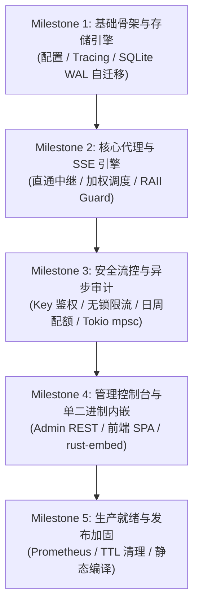

# rs-gate: 阶段二系统架构设计 (SDD) 提示词指令

## 角色定位与工程原则
你是一名资深分布式系统架构师与 Rust 全栈技术专家。我们正在采用 **规范驱动开发 (Spec-Driven Development, SDD)** 模式开发 **rs-gate（轻量级、单二进制交付的企业级内部大模型网关）**。

在阶段一特性清单与边界界定规范（[`docs/01-features/01-feature-matrix.md`](file:///home/fugui/rusts/rs-gate/docs/01-features/01-feature-matrix.md)）已定稿并检视通过的基础上，现在正式进入：
**「阶段二：系统架构设计文档编制」**。

---

## 任务目标与设计文档矩阵 (Design Docs Matrix)

为避免单一文档体积膨胀导致上下文超载与职责混乱，阶段二系统架构设计采用 **「1 篇总览核心架构 + 3 篇深度子系统规范」** 的总分系列矩阵组织：

| 文档路径 | 规范类型 | 核心职责与设计边界 |
| :--- | :--- | :--- |
| [`docs/02-design/01-system-architecture.md`](file:///home/fugui/rusts/rs-gate/docs/02-design/01-system-architecture.md) | **【总览篇】系统总架构** | 系统分层架构图、端到端请求生命周期序列图、`src/` 与 `web/` 模块分层与核心公共 Trait 定义、单二进制嵌入方案 |
| [`docs/02-design/02-storage-and-models.md`](file:///home/fugui/rusts/rs-gate/docs/02-design/02-storage-and-models.md) | **【存储篇】存储模型与迁移** | SQLite WAL 存储引擎、完整 DDL 物理建模、复合索引与查询优化、`migrations/` 声明式自初始化与升迁机制 |
| [`docs/02-design/03-routing-and-proxy.md`](file:///home/fugui/rusts/rs-gate/docs/02-design/03-routing-and-proxy.md) | **【代理篇】调度与流式中继** | 多协议原生直通代理、加权最小活跃长连接算法 (无除法交叉乘法)、`ActiveConnectionGuard` (RAII 防泄漏)、SSE 零缓冲透传、Token usage 提取与 Abort 中断传导 |
| [`docs/02-design/04-limiting-and-audit.md`](file:///home/fugui/rusts/rs-gate/docs/02-design/04-limiting-and-audit.md) | **【流控与审计篇】安全与审计** | 虚拟 Key 鉴权与脱敏、后端物理凭据隔离、无锁令牌桶限流 (RPM/并发)、日/周双层配额 (Daily & Weekly Quotas) 阻断、Tokio mpsc 异步落盘流水线 |

> **红线提示**：本阶段**严禁编写任何业务源码与测试代码**，只产出上述 4 篇系统架构设计规范。

---

## 核心设计要求与技术约束 (Technical Guardrails)

文档编制必须全面覆盖以下 8 大核心架构维度，并深入解决阶段一检视发现的关键工程细节：

### 1. 端到端系统架构与数据流流水线 (对应 `01-system-architecture.md`)
- 绘制整体系统分层架构图（Mermaid 格式），涵盖：网络接入层、鉴权与流控层、路由调度层、SSE 透传中继层、异步审计落盘管道与嵌入式 Web 管理控制台。
- 详细绘制客户端 HTTP/SSE 请求的端到端生命周期序列图 (Sequence Diagram)：
  `Client -> 鉴权校验 -> 令牌桶与日/周配额预检 -> 路由集群选路 -> 活跃连接计数绑定 -> Upstream 中继转发 -> 流式 Chunk 实时透传与 Usage 提取 -> 释放连接计数 -> 异步审计事件投递 -> 批量落盘`。
- 定义 `src/` 与 `web/` 的模块与目录层级规范（高内聚、低耦合、清晰分层），明确各个子模块职责边界。

### 2. 调度算法与并发控制设计 (对应 `03-routing-and-proxy.md`)
- **调度选路算法落地**：落实基于加权最小活跃长连接算法，**明确采用无除法交叉乘法比较**（$\text{Compare}(A, B) \iff C_A \times W_B \text{ vs } C_B \times W_A$），杜绝整除截断丢失精度；定义多节点负载相等时的平滑轮询机制与冷启动选路策略。
- **RAII 连接泄漏终极防护**：设计 `ActiveConnectionGuard` 模式，利用 Rust 的 `Drop` trait 机制确保在客户端断连、请求超时、网络重置或 Tokio 任务取消时，`C_i.fetch_sub(1)` 必然触发，绝不发生长连接泄漏。
- **客户端 Abort 中断传导**：设计客户端断开时向后端 Upstream 发送取消信号并释放连接的完整异步传导机制。

### 3. 多协议原生直通与低延迟 SSE 流式引擎 (对应 `03-routing-and-proxy.md`)
- **直通端点设计**：定义 `/v1/chat/completions`、`/v1/responses`、`/v1/completions`、`/v1/embeddings`、`/v1/rerank` 与 `/v1/models` 的透明转发契约；坚持零跨协议 AST 转换损耗。
- **SSE 流式解析与 Token 计量**：设计非阻塞异步管道的逐 chunk 透传机制；定义 `usage` 提取算法（兼容 `stream_options.include_usage`）；明确缺少 usage 时的兜底策略。
- **流式透支防范策略**：明确日/周配额在流式场景下的准入门槛（$Quota - Used \ge MinReserve$）与超额透支判定策略。

### 4. 后端服务器集群与协议能力预先探测 (对应 `03-routing-and-proxy.md`)
- **探测策略与凭证注入**：设计后端添加与心跳探测时的能力识别机制，必须注入后端托管凭据；优先采用 `OPTIONS` / `HEAD` 或轻量探测包，精准区分 200/400（支持）与 404/405（不支持）。
- **能力位掩码与内存状态**：定义后端节点内存结构中的协议能力位图（`ProtocolType` bitflags / HashSet）与健康状态机（Healthy / Degraded / Unhealthy / CircuitBroken）。

### 5. 存储架构与声明式演进方案 (对应 `02-storage-and-models.md`)
- **数据库模式设计**：基于 SQLite WAL 模式，输出完整的 DDL 物理数据模型，包括：
  - `admin_users`（管理员用户与密码 Hash）；
  - `virtual_keys`（虚拟 Key 摘要、归属、日/周配额上限与重置周期）；
  - `backend_servers`（物理后端实例、地址、权重、托管凭据、探测能力集、健康状态）；
  - `models` 与 `model_backends`（逻辑模型定义及其后端的关联与权重映射）；
  - `audit_logs`（审计调用流水、Token 消耗、请求耗时、状态码、Trace ID）；
  - `quota_usages`（租户日/周周期 Token 累计表）。
- **索引与查询优化**：为审计检索设计前缀/组合索引，保障 10 万级日志下响应 $\le 50\text{ms}$。
- **声明式迁移机制**：定义 `migrations/` 目录的 DDL 文件加载、校验与自升迁逻辑。

### 6. 流控安全与异步审计存储管道 (对应 `04-limiting-and-audit.md`)
- **鉴权与隔离**：虚拟 API Key 加盐 Hash 脱敏持久化（SHA-256 / Argon2）；后端真实凭据物理屏蔽隔离。
- **原子令牌桶与日/周配额**：无锁原子结构维护 RPM 与并发连接数；基于日/周周期的 Token 配额硬拦截与自动重置时间戳计算。
- **Tokio mpsc 解耦落盘**：采用 Tokio 有界通道解耦代理热路径与 SQLite 磁盘 I/O；定义批量刷盘 Worker（基于 500ms 窗口或 100 条批量事务提交）与队列溢出背压策略。

### 7. 嵌入式 Web 控制台与单二进制打包方案 (对应 `01-system-architecture.md`)
- **静态资源内嵌方案**：设计通过 `rust-embed` 将前端产物打包至二进制文件的集成流程与 HTTP 静态文件路由分发（含 SPA Fallback 机制）。
- **API 隔离与统一端口**：定义网关代理请求路由与管理后台 REST API 路由的分发策略（支持统一端口或独立端口监听）。

---

## 后续工程实施流水线规划 (Implementation Roadmap)

在阶段二架构设计与阶段三任务验收清单编制完成后，工程实施**坚决不进行一次性堆砌，严格拆解为以下 5 个递进 Milestone**：

### 各 Milestone 实施边界与最小可用验收标准 (Acceptance Criteria)

1. **Milestone 1：基础骨架与存储引擎 (Foundation & Storage Engine)**
   - **交付重点**：Cargo 模块骨架、全局配置系统、`tracing` 日志、SQLite WAL 存储连接池与 `migrations/` 声明式自初始化。
   - **验收标准**：本地 `cargo test` 全过，执行启动即在本地自创建 `.db` 并成功建表，暴露健康检查端点 `/health/live`。
2. **Milestone 2：核心直通代理与调度引擎 (Core Passthrough & SSE Engine)**
   - **交付重点**：多协议端点注册 (`/v1/chat/...` 等)、加权最小活跃长连接调度器、`ActiveConnectionGuard` (RAII)、SSE 零缓冲实时透传、Usage 提取、客户端 Abort 级联中断。
   - **验收标准**：配合真实或模拟 vLLM 实例，通过 `curl` 发起非流式与流式 SSE 调用，首字透传延迟符合指标（Overhead $\le 1\text{ms}$）。
3. **Milestone 3：流控安全与异步审计管道 (Limiting & Async Audit)**
   - **交付重点**：虚拟 Key 鉴权、无锁原子令牌桶 (RPM/并发)、**日/周双层配额 (Daily & Weekly Quotas)** 判定、Tokio 有界通道异步落盘 Worker。
   - **验收标准**：未授权 Key 快速返回 401，超限请求拦截 429，配额用尽硬阻断，高并发请求下审计流水无阻塞、无丢失写入 SQLite WAL。
4. **Milestone 4：管理控制台与单二进制内嵌 (Admin Web & Single Binary)**
   - **交付重点**：管理后台 REST API 契约落地、前端 SPA 界面（后端能力徽章、日/周双进度条、模型热更新、审计检索）、`rust-embed` 单二进制内嵌。
   - **验收标准**：仅运行单个二进制文件，浏览器访问直接展示管理控制台，支持全生命周期配置与日志下钻。
5. **Milestone 5：生产就绪与打包加固 (Hardening, Metrics & Release)**
   - **交付重点**：`/metrics` Prometheus 指标采集、历史日志 TTL 定时滚动清理、全链路集成回归测试、跨平台静态编译（musl/static）。
   - **验收标准**：`cargo clippy` 零警告，所有单元与集成测试通过，输出免外部依赖单二进制制品。

---

## 交付产物与格式要求
1. **目标文件**：
   - [`docs/02-design/01-system-architecture.md`](file:///home/fugui/rusts/rs-gate/docs/02-design/01-system-architecture.md)
   - [`docs/02-design/02-storage-and-models.md`](file:///home/fugui/rusts/rs-gate/docs/02-design/02-storage-and-models.md)
   - [`docs/02-design/03-routing-and-proxy.md`](file:///home/fugui/rusts/rs-gate/docs/02-design/03-routing-and-proxy.md)
   - [`docs/02-design/04-limiting-and-audit.md`](file:///home/fugui/rusts/rs-gate/docs/02-design/04-limiting-and-audit.md)
2. **图表规范**：包含高清晰度的 Mermaid 架构图、数据流图与序列图。
3. **技术红线**：严禁伪代码敷衍，关键数据结构必须使用清晰规范的 Rust 类型定义（Struct / Enum / Trait）；关键 SQL DDL 必须完整可执行。
