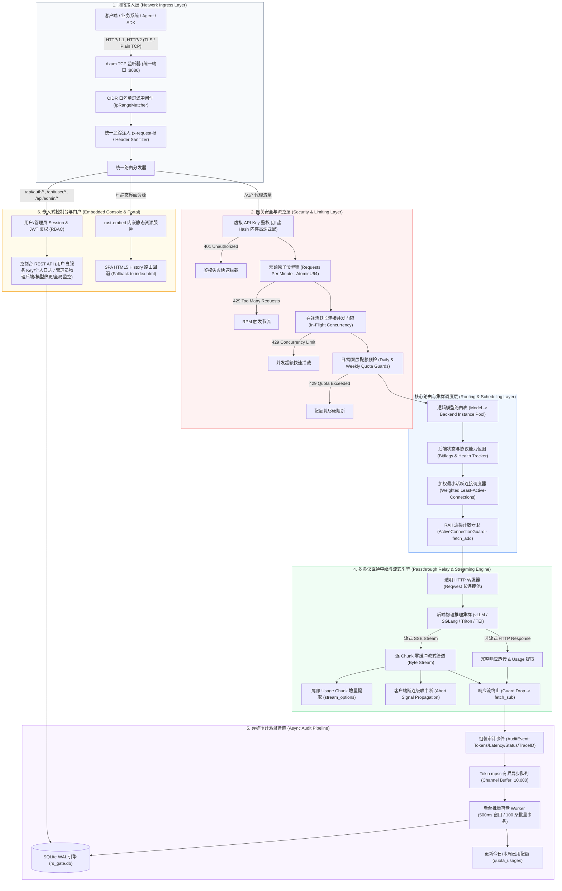
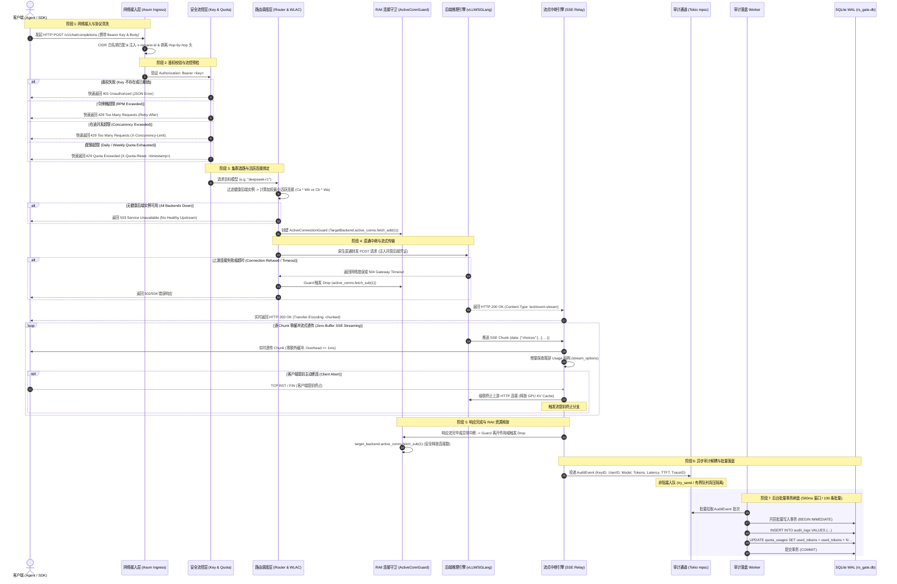
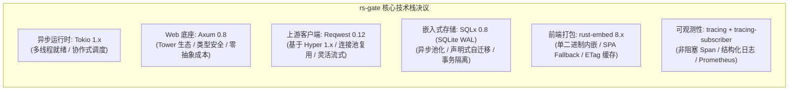
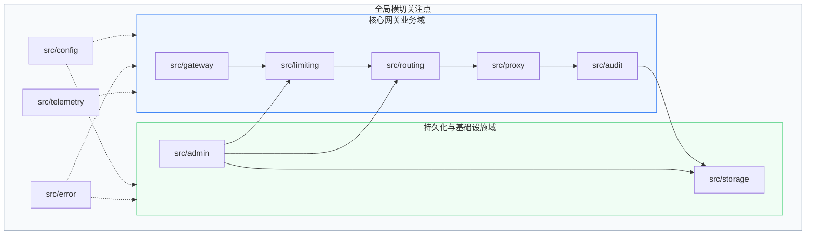
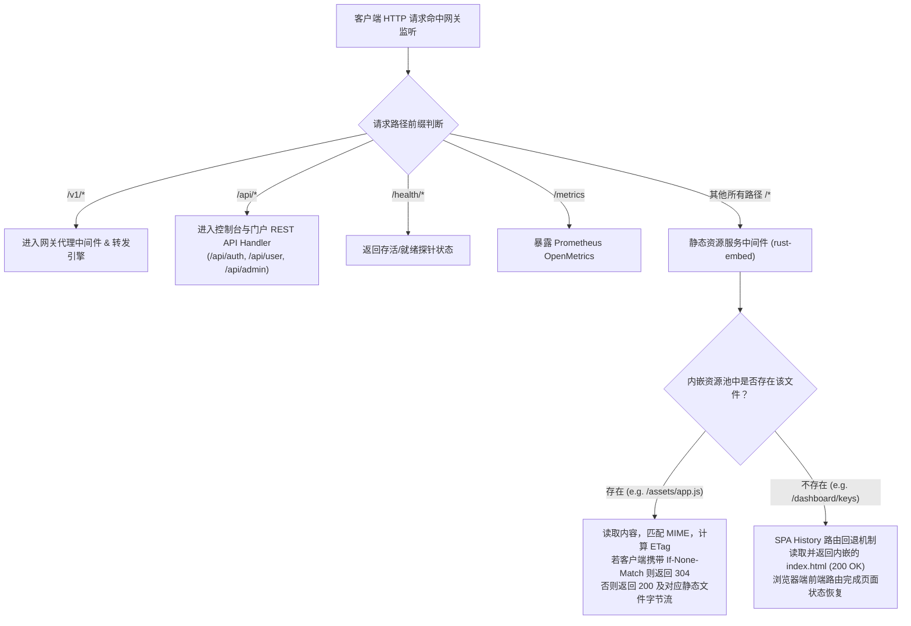
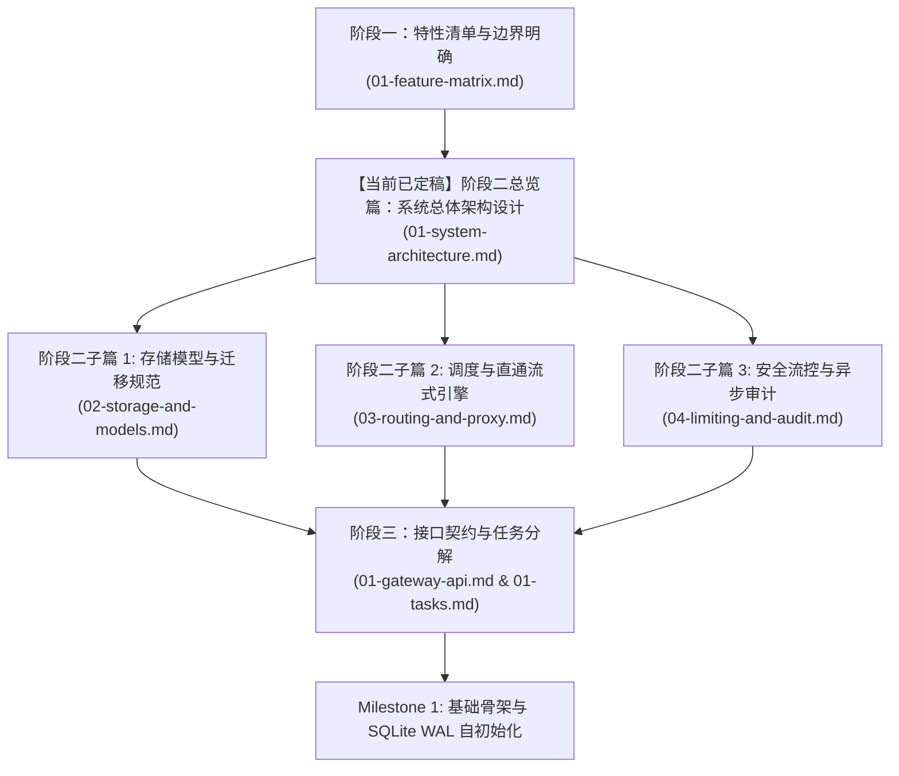

# rs-gate 系统总体架构设计规范 (System Layered Architecture)

- **文档编号**：`01-system-architecture.md`
- **文档版本**：`v1.0.0`
- **编制日期**：2026-10-18
- **当前阶段**：阶段二：系统架构设计 (第 1 步：总览篇)
- **基准依赖**：[`docs/01-features/01-feature-matrix.md`](file:///home/fugui/rusts/rs-gate/docs/01-features/01-feature-matrix.md)
- **状态**：定稿待审 (Ready for Review)

---

## 1. 架构愿景与设计哲学 (Vision & Architectural Principles)

### 1.1 系统定位
**rs-gate** 是一款采用 Rust 构建的高性能、低资源占用、单二进制交付的企业级内部大模型网关。它作为企业内部所有业务系统与底层高性能推理引擎（vLLM、SGLang、Triton、TEI、Ollama 等）及外部上游提供商之间的统一接入中枢与安全防线，解决企业大模型应用落地过程中的**凭据泄露风险**、**调用配额无序**、**异构请求并发倾斜雪崩**、**账单计量混乱**以及**运维部署沉重**等痛点。

### 1.2 核心架构设计原则
1. **轻量极致，单二进制开箱即用 (Single Binary & Zero External Middleware)**
   - 坚守**单二进制、零外部组件依赖**的架构红线。无需安装 Node.js、Redis、MySQL 或 Kafka。
   - 控制台前端 SPA 产物通过 `rust-embed` 编译期内嵌；持久化存储由嵌入式 SQLite WAL 承载；限流与连接度量在进程内基于无锁原子结构闭环。
2. **多协议原生直通，零 AST 转换损耗 (Passthrough-First)**
   - 网关定位为**高性能透明中继器**而非重型转换器。对后端 vLLM/SGLang 实施原生协议直通（`/v1/chat/completions`、`/v1/responses`、`/v1/completions`、`/v1/embeddings`、`/v1/rerank`、`/v1/models`）。
   - 杜绝昂贵的跨厂商协议 AST 深度语义重构，保证网关内部附加延迟 $P99 \le 1.5\text{ms}$。
3. **低延迟非阻塞流式管道 (Zero-Buffer SSE Streaming)**
   - 针对 SSE 流式响应，采用异步非阻塞管道逐 Chunk 边读边写实时透传，严禁全量缓冲。
   - 首字透传延迟（TTFT Overhead）控制在 $\le 1\text{ms}$。
4. **长短请求倾斜治理 (Weighted Least-Active-Connections)**
   - 针对 LLM 推理场景中“短查询数十毫秒”与“深度长思考长连接数十秒”并存的极端异构性，抛弃传统请求计数轮询，全面落实基于**实时在途长连接数与权重比值**的动态调度。
   - 算法采用**无除法交叉乘法**比较，杜绝整除截断丢失精度；结合 Rust RAII 守卫模式杜绝长连接计数泄漏。
5. **企业级两层配额防线 (Daily & Weekly Quotas)**
   - 提供针对虚拟 Key 的**每日 (Daily)** 与**每周 (Weekly)** 双层 Token 配额双重保险，严格防范单日突发冲击与单周累积滥用。
6. **强类型与内存安全 (Type-Safety & Resource RAII)**
   - 业务逻辑 100% 采用 Safe Rust 编写，严禁在生产路径中使用不安全解包（`unwrap()` / `expect()`）。
   - 连接生命周期由 RAII 守卫严格管理，异常路径、超时与客户端取消（Abort）均能可靠回收资源。

---

## 2. 系统总体分层架构 (System Layered Architecture)

系统自顶向下划分为六大核心架构分层，各层之间通过强类型契约解耦，数据流与控制流职责清晰。



### 2.1 各架构分层职责详解

| 分层名称 | 核心职责 | 技术实现与组件 | 性能与 SLA 约束 |
| :--- | :--- | :--- | :--- |
| **1. 网络接入层** | 统一端口监听、TCP 握手管理、CIDR 网段白名单校验、协议头剥离与清洗、全局唯一 Trace ID 生成与注入。 | Axum 0.8, Tower Layer, `ipnet` CIDR Matcher | 网关入口耗时 $\le 0.1\text{ms}$，非法 IP 快速 403 拒止。 |
| **2. 安全与流控层** | 虚拟 API Key 鉴权校验、无锁原子令牌桶（RPM）限流、在途长连接并发门限拦截、日/周两级 Token 配额准入与超额阻断。 | SHA-256 加盐 Hash 内存匹配、`AtomicU64` 令牌桶、`AtomicUsize` 并发计数、Chrono 时区计算 | 鉴权与流控判定延迟 $\le 0.2\text{ms}$；超额请求立即返回 429。 |
| **3. 核心路由与调度层** | 维护逻辑模型到物理后端池的映射；周期性协议能力预探测；执行加权最小活跃长连接（WLAC）无除法交叉乘法选路；绑定 RAII 活跃连接守卫。 | 读写锁缓存 `Arc<RwLock<RouteTable>>`、`ActiveConnectionGuard` | 选路计算耗时 $\le 0.05\text{ms}$，无活跃长连接泄漏。 |
| **4. 直通中继与流式引擎** | 原生多协议透明转发、Reqwest 长连接池复用、逐 Chunk 零缓冲流式透传、增量 Token Usage 提取、客户端 Abort 级联中断与资源释放。 | Reqwest Client、`tokio_stream`、`async-stream`、`bytes::Bytes` | 首字透传延迟 (TTFT Overhead) $\le 1\text{ms}$，内存零拷贝/零额外缓冲。 |
| **5. 异步审计管道** | 组装调用审计流水，通过 Tokio mpsc 有界通道投递，后台独立 Worker 触发批量事务刷盘，同步维护日/周累积配额，定期执行历史数据 TTL 清理。 | Tokio mpsc (有界 10,000)、SQLx SQLite WAL、批量提交 Worker | 代理热路径无锁非阻塞（投递耗时 $\le 0.02\text{ms}$），落盘抖动零扩散。 |
| **6. 嵌入式控制台与门户** | 静态编译内嵌 Web SPA 资源、MIME 嗅探与缓存头注入、SPA 路由回退、用户自服务与管理员配置热更新 REST API、监控指标大盘分发。 | `rust-embed`、Axum ServeDir/ServeFile、JWT RBAC 鉴权、Prometheus `/metrics` | 单二进制自包含，无外部静态资源网络依赖。 |

---

## 3. 端到端请求生命周期序列 (Request Lifecycle & Sequence)

本序列图覆盖客户端从发起请求、鉴权流控、调度选路、上游中继、SSE 零缓冲透传、Usage 提取、RAII 释放连接，到最终异步审计落盘的全生命周期闭环，包含全部典型异常分支。



---

## 4. 核心技术底座选型决议矩阵 (Tech Stack Decision Matrix)

rs-gate 面临高并发长连接保持、极端低延迟中继、零中间件依赖及极简运维的复合挑战。以下为关键技术底座的系统性权衡与定稿决议：



### 4.1 详细选型论证与对比矩阵

| 技术维度 | 候选方案 | 最终决议 | 选型权衡与核心采纳理由 |
| :--- | :--- | :---: | :--- |
| **异步运行时** | **Tokio** vs `async-std` vs `smol` | **Tokio 1.x (full)** | 1. **行业标准与生态粘合度**：Axum、Hyper、Reqwest、SQLx 均首选并原生深度依赖 Tokio 运行时。<br>2. **成熟的任务控制**：拥有成熟的协作式任务取消、超时驱动（`tokio::time`）、高效有界管道（`tokio::sync::mpsc`）与优雅停机通知（`CancellationToken`）。<br>3. **工作窃取调度器**：多线程 Work-Stealing 调度机制在大并发 I/O 密集型网关场景表现优异。 |
| **Web 接入底座** | **Axum** vs `Actix-web` vs `Rocket` | **Axum 0.8** | 1. **模块化与解耦**：由 Tokio 官方团队维护，设计纯粹贴近 HTTP 原生语义，零不可见宏黑盒。<br>2. **强大的中间件生态**：原生基于 Tower / Tower-HTTP 中间件生态，CIDR 过滤、Trace ID 注入、超时控制均可复用经过严苛验证的中间件。<br>3. **极致的类型安全提取器**：通过 `State`、`Path`、`Json` 等提取器极大降低 Handler 样板代码，提升可维护性。<br>4. **Actix-web 权衡**：虽然 Actix-web 极速，但其 Actor 历史遗产与独立的运行时抽象增加了与通用 Tokio 库协同的摩擦成本。 |
| **上游 HTTP 客户端** | **Reqwest** vs `Hyper Client (raw)` vs `Isahc` | **Reqwest 0.12 (基于 Hyper 1.x)** | 1. **兼顾极致性能与生产可用性**：底层基于 Hyper 1.x 纯异步非阻塞引擎，具备极佳的 HTTP/1.1、HTTP/2 连接池管理能力。<br>2. **直观的流式消费抽象**：提供 `bytes_stream()` 接口，能够以流式零拷贝方式获取上游 SSE 响应并无缝转换为 Axum 响应流。<br>3. **健全的连接池保活配置**：支持精细化配置 `pool_idle_timeout`、`pool_max_idle_per_host` 和 `tcp_keepalive`，规避底层物理后端空闲连接被防火墙静默丢弃。<br>4. **原生 Hyper 权衡**：直接操作裸 Hyper 1.x 需要自行手写重型连接池与 TLS 逻辑，开发成本极高且易引入连接维护缺陷。 |
| **嵌入式数据库与迁移** | **SQLx (SQLite)** vs `rusqlite` vs `Diesel` | **SQLx 0.8 (SQLite WAL)** | 1. **全异步驱动**：与 Axum/Tokio 全异步模型无缝融合，避免在同步数据库驱动中因调用 `block_in_place` 或 `spawn_blocking` 导致线程池资源竞争。<br>2. **内置异步连接池**：提供开箱即用的 `SqlitePool`，完美支持 WAL 模式下的“多读者单写者”并发访问模型。<br>3. **原生声明式迁移**：内置 `sqlx::migrate!()` 宏，支持将 `migrations/*.sql` 文件编译期打入二进制，启动时自动比对校验版本并执行幂等升级。<br>4. **rusqlite 权衡**：rusqlite 为同步 API，在高吞吐批量审计插入时必须配合后台独占线程与管道调度，与 SQLx 相比增加了样板逻辑。 |
| **单二进制静态内嵌** | **`rust-embed`** vs `include_dir` vs `include_bytes!` | **`rust-embed 8.x`** | 1. **完善的静态资源服务**：支持根据文件后缀自动推断 MIME 类型，支持自动生成 ETag，支持客户端 `If-None-Match` 协商缓存返回 304。<br>2. **SPA 友好**：易于实现客户端单页应用（SPA）的历史路由回退逻辑（非 API 路由且未匹配静态文件时自动 Fallback 至 `index.html`）。<br>3. **开箱即用打包**：前端构建产物只需放置在约定目录即可由宏直接打包进最终可执行文件。 |
| **遥测与链路追踪** | **`tracing`** vs `log` / `env_logger` | **`tracing` + `tracing-subscriber`** | 1. **异步上下文透传**：支持跨 `await` 边界的 Span 树状上下文传递，请求生命周期可完整追溯。<br>2. **高性能结构化输出**：支持生产环境 JSON 格式输出与开发环境可读格式输出；通过 Filter 机制支持动态热调整日志级别。<br>3. **Prometheus 指标集成**：配合 `metrics` + `metrics-exporter-prometheus`，轻松暴露 `/metrics` 监控端点。 |
| **密码安全与凭据哈希** | **`sha2` + `argon2`** vs `bcrypt` | **`sha2` (Key 摘要) + `argon2` (管理员密码)** | 1. **虚拟 Key 高速校验**：网关虚拟 Key 采用 SHA-256 加盐 Hash 内存匹配，纳秒级比对，杜绝数据库明文泄露。<br>2. **控制台防暴力破解**：管理员登录密码采用 Argon2id 内存硬哈希算法，有效抵御 GPU 暴力破解。 |

---

## 5. 代码子模块组织与工程目录规范 (Project Layout & Module Organization)

为了保障系统高内聚、低耦合，严密遵从 AGENTS.md 划定的目录隔离红线，系统核心源码统一收敛在 `src/`，控制台前端收敛在 `web/`，数据库版本迁移脚本收敛在 `migrations/`。

### 5.1 工程全景目录树

```text
rs-gate/
├── Cargo.toml                      # 项目清单与核心依赖声明
├── Cargo.lock                      # 依赖版本锁定
├── AGENTS.md                       # 架构宪法与开发准则
├── README.md                       # 项目主页与开发指南
├── migrations/                     # SQLite 声明式 DDL 版本迁移文件
│   └── 20261018000000_init.sql     # 初始建表脚本 (WAL、索引、实体表)
├── src/                            # 后端核心 Rust 源码
│   ├── main.rs                     # 启动入口、命令行解析、优雅停机编排
│   ├── lib.rs                      # 顶层子模块汇聚与公共重导出
│   ├── config/                     # 配置管理子模块
│   │   ├── mod.rs                  # 配置加载入口、默认值与环境变量映射
│   │   └── settings.rs             # 全局强类型配置结构体定义
│   ├── error/                      # 统一错误处理体系
│   │   ├── mod.rs                  # GatewayError 强类型枚举与 Result 别名
│   │   └── response.rs             # Axum IntoResponse 适配与 JSON 错误协议规范
│   ├── gateway/                    # 网关网络接入与路由分流
│   │   ├── mod.rs                  # 路由组装与 Axum Router 暴露
│   │   ├── middleware.rs           # CIDR 白名单过滤、Trace ID 注入、协议头清洗
│   │   └── handlers.rs             # 多协议代理统一入口 Handler
│   ├── limiting/                   # 安全鉴权与多维流控
│   │   ├── mod.rs                  # 鉴权与流控管理器装配
│   │   ├── auth.rs                 # 虚拟 Key 加盐 Hash 校验与内存缓存
│   │   ├── token_bucket.rs         # 无锁原子令牌桶 (RPM 限流)
│   │   ├── concurrency.rs          # 在途长连接并发控制器
│   │   └── quota.rs                # 日/周双层配额计算与拦截器
│   ├── routing/                    # 模型路由与集群调度
│   │   ├── mod.rs                  # 路由表状态与更新协调
│   │   ├── scheduler.rs            # 加权最小活跃长连接调度器 (WLAC 无除法交叉乘法)
│   │   ├── prober.rs               # 后端协议能力预探测与心跳探活
│   │   └── instance.rs             # 后端物理节点定义与健康状态机
│   ├── proxy/                      # 直通中继与流式核心引擎
│   │   ├── mod.rs                  # Proxy 服务入口
│   │   ├── client.rs               # Reqwest 客户端池化装配与保活配置
│   │   ├── relay.rs                # 原生请求转发与非流式透传
│   │   ├── sse.rs                  # SSE 逐 Chunk 零缓冲流式管道
│   │   ├── usage.rs                # 流式 Usage 增量解析器
│   │   └── guard.rs                # RAII ActiveConnectionGuard 活跃连接守卫
│   ├── storage/                    # 存储层与数据访问对象 (DAO)
│   │   ├── mod.rs                  # SqlitePool 初始化与 WAL 参数调优
│   │   ├── migrator.rs             # 声明式 DDL 自动自初始化与升迁检查
│   │   ├── models.rs               # 数据库实体持久化结构 (Entities)
│   │   └── dao/                    # 数据访问层细分子模块
│   │       ├── mod.rs
│   │       ├── key_dao.rs          # 虚拟 Key 持久化与配额重置
│   │       ├── backend_dao.rs      # 后端实例与能力配置持久化
│   │       ├── model_dao.rs        # 逻辑模型映射持久化
│   │       ├── audit_dao.rs        # 审计日志检索与批量写入
│   │       └── admin_dao.rs        # 管理员账户与认证持久化
│   ├── audit/                      # 异步审计流水管道
│   │   ├── mod.rs                  # 审计管道初始化
│   │   ├── event.rs                # AuditEvent 数据结构
│   │   ├── channel.rs              # Tokio mpsc 有界通道发送端抽象
│   │   └── worker.rs               # 后台批量刷盘 Worker (时间窗口与批量事务)
│   ├── web/                        # 控制台与自服务门户 REST API
│   │   ├── mod.rs                  # Web 路由注册与 RBAC 中间件
│   │   ├── auth.rs                 # 用户/管理员登录鉴权与 Session/JWT 中间件
│   │   ├── user_api.rs             # 普通用户自服务接口 (个人 Key、配额进度、个人日志)
│   │   ├── admin_key_api.rs        # 管理员 Key 全局管控与配额重置接口
│   │   ├── backend_api.rs          # 后端实例管理与即时能力探测触发
│   │   ├── model_api.rs            # 模型绑定与权重热配置接口
│   │   ├── audit_api.rs            # 全局审计日志多维筛选与分页导出
│   │   └── stats_api.rs            # 流量看板与吞吐统计接口
│   ├── embedded/                   # 静态资产内嵌与 SPA 服务
│   │   ├── mod.rs                  # rust-embed 资源绑定定义
│   │   └── fallback.rs             # MIME 嗅探与 SPA HTML5 Fallback 处理
│   └── telemetry/                  # 可观测性与监控
│       ├── mod.rs                  # tracing 初始化与格式化配置
│       └── metrics.rs              # Prometheus OpenMetrics 采集与导出
├── web/                            # 前端管理控制台源码 (Vanilla/Modern SPA)
│   ├── index.html                  # 单页应用入口
│   ├── package.json                # 前端工程配置与构建脚本
│   ├── src/                        # 前端逻辑与样式
│   └── dist/                       # 前端构建输出目录 (供 rust-embed 编译期内嵌)
└── tests/                          # 集成与回归测试
    ├── common/                     # 共享测试脚手架与 Mock 服务器
    ├── gateway_passthrough_test.rs # 核心直通与多协议代理测试
    ├── sse_streaming_test.rs       # SSE 逐 Chunk 延迟与 Abort 级联测试
    ├── limiting_quota_test.rs      # RPM 与日/周配额超额测试
    └── wlac_scheduler_test.rs      # 加权最小活跃连接调度回归测试
```

### 5.2 子模块职责边界规范



1. **`src/gateway/`**：仅负责 HTTP 请求的入口拦截、协议头清洗、CIDR 白名单鉴权与路由派发，严禁直接读写数据库。
2. **`src/limiting/`**：仅负责内存维度的虚拟 Key 鉴权校验、原子令牌桶更新、并发门限比对及配额预检，判定超限直接返回 429。
3. **`src/routing/`**：仅负责维护内存中的健康节点拓扑、协议支持位掩码与执行加权最小活跃连接算法选路，对上游真实连接细节无感知。
4. **`src/proxy/`**：纯粹的直通中继与流式传输引擎，负责连接后端推理引擎、双向透传数据流、解析 Usage，并由 RAII 守卫自动管理活跃连接数。
5. **`src/audit/`**：通过 Tokio mpsc 有界通道完全解耦代理主路径，负责将审计记录聚合成批并写入数据库，严禁将写入压力反向传导至网关中继流。
6. **`src/storage/`**：负责 SQLite WAL 模式连接池的生命周期、DDL 声明式迁移与数据持久化 DAO，提供纯异步数据存取接口。
7. **`src/admin/`**：控制台管理 API 专属子模块，负责业务配置的增删改查，并触发内存路由表和配额状态的热更新。
8. **`src/embedded/`**：负责 `rust-embed` 静态文件的内存加载、MIME 类型设置及 SPA 路由回退，与后端 API 路由严格隔离。

---

## 6. 核心公共 Trait 与数据契约抽象规范 (Core Traits & Data Contracts)

为了保证后续 Milestone 能够无缝开展具体实现，杜绝伪代码敷衍，本节严格以规范的 Rust 类型系统定义核心数据契约与接口抽象。

### 6.1 协议能力与后端实例抽象

```rust
use std::sync::atomic::{AtomicUsize, Ordering};
use std::sync::Arc;
use chrono::{DateTime, Utc};
use serde::{Deserialize, Serialize};

/// 后端所支持的原生大模型协议端点类型位掩码
#[derive(Debug, Clone, Copy, PartialEq, Eq, Hash, Serialize, Deserialize)]
#[repr(u32)]
pub enum ProtocolType {
    /// /v1/chat/completions (OpenAI Chat)
    ChatCompletions = 1 << 0,
    /// /v1/responses (OpenAI Agentic Responses API)
    Responses       = 1 << 1,
    /// /v1/completions (Legacy Completions)
    Completions     = 1 << 2,
    /// /v1/embeddings (Vector Embeddings)
    Embeddings      = 1 << 3,
    /// /v1/rerank (Cross-Encoder Reranking)
    Rerank          = 1 << 4,
    /// /v1/models (Model Metadata Query)
    Models          = 1 << 5,
}

/// 后端节点健康状态机
#[derive(Debug, Clone, Copy, PartialEq, Eq, Serialize, Deserialize)]
pub enum BackendHealthStatus {
    /// 健康正常，参与加权最小活跃长连接调度
    Healthy,
    /// 降级运行（如近期出现偶发超时，调低其调度权重）
    Degraded,
    /// 异常探活失败，暂时隔离脱机
    Unhealthy,
    /// 熔断状态（连续 5xx 达到阈值，触发快速失败，等待探活恢复）
    CircuitBroken,
}

/// 内存中的后端物理服务器实例模型
#[derive(Debug)]
pub struct BackendInstance {
    /// 后端唯一标识
    pub id: String,
    /// 显示名称
    pub name: String,
    /// 基础网络接入地址 (e.g. "http://192.168.1.100:8000")
    pub base_url: String,
    /// 调度权重 (正整数，默认 10)
    pub weight: u32,
    /// 实时在途长连接数 (原子操作，保证线程安全)
    pub active_connections: Arc<AtomicUsize>,
    /// 预探测支持的协议能力集合
    pub capabilities: Vec<ProtocolType>,
    /// 当前健康状态
    pub health_status: BackendHealthStatus,
    /// 网关代管的上游真实认证凭据 (物理屏蔽，不向外泄露)
    pub upstream_api_key: Option<String>,
    /// 最近一次探活成功时间戳
    pub last_probe_at: Option<DateTime<Utc>>,
}
```

### 6.2 RAII 活跃长连接泄漏守卫 (ActiveConnectionGuard)

```rust
/// RAII 守卫：利用 Rust Drop 机制在任何异常、超时或客户端断连时强制递减长连接计数
#[derive(Debug)]
pub struct ActiveConnectionGuard {
    counter: Arc<AtomicUsize>,
    backend_id: String,
}

impl ActiveConnectionGuard {
    /// 在请求选路确定后创建守卫，立即原子自增
    pub fn new(counter: Arc<AtomicUsize>, backend_id: String) -> Self {
        counter.fetch_add(1, Ordering::SeqCst);
        Self { counter, backend_id }
    }

    /// 获取关联的后端 ID
    pub fn backend_id(&self) -> &str {
        &self.backend_id
    }
}

impl Drop for ActiveConnectionGuard {
    fn drop(&mut self) {
        // 请求流结束（无论正常、报错还是客户端取消），必然触发原子自减
        self.counter.fetch_sub(1, Ordering::SeqCst);
    }
}
```

### 6.3 调度器与路由 Trait

```rust
use async_trait::async_trait;
use crate::error::GatewayError;

/// 后端集群调度器核心抽象
pub trait BackendScheduler: Send + Sync {
    /// 基于加权最小活跃连接算法选路
    /// 采用无除法交叉乘法比较: Ca * Wb vs Cb * Wa
    fn select_backend(
        &self,
        model: &str,
        protocol: ProtocolType,
    ) -> Result<(Arc<BackendInstance>, ActiveConnectionGuard), GatewayError>;

    /// 上报后端调用结果以支持熔断与状态转移
    fn report_result(&self, backend_id: &str, is_success: bool, latency_ms: u64);
}

/// 后端能力预先探测抽象
#[async_trait]
pub trait CapabilityProber: Send + Sync {
    /// 探测指定后端实例支持的端点类型集合
    async fn probe_capabilities(&self, instance: &BackendInstance) -> Vec<ProtocolType>;
    /// 探活单个后端健康度
    async fn check_health(&self, instance: &BackendInstance) -> BackendHealthStatus;
}
```

### 6.4 安全鉴权、流控与双层配额 Trait

```rust
use std::sync::atomic::AtomicU64;

/// 虚拟 Key 鉴权通过后的身份与限额上下文
#[derive(Debug, Clone)]
pub struct VirtualKeyIdentity {
    pub key_id: String,
    pub user_id: String, // 归属用户 ID (支持用户数据隔离与审计追踪)
    pub key_hash: String,
    pub name: String,
    pub allowed_models: Vec<String>,
    pub rpm_limit: u32,
    pub max_concurrency: usize,
    /// 每日配额上限 (Token 数量，0 代表不限制)
    pub daily_token_quota: u64,
    /// 每周配额上限 (Token 数量，0 代表不限制)
    pub weekly_token_quota: u64,
}

/// 配额预检与判定结果
#[derive(Debug, Clone, Copy, PartialEq, Eq)]
pub enum QuotaCheckResult {
    Allowed,
    DailyQuotaExceeded { reset_at: i64 },
    WeeklyQuotaExceeded { reset_at: i64 },
}

/// 鉴权与安全管理器核心 Trait
#[async_trait]
pub trait KeyAuthenticator: Send + Sync {
    /// 基于请求头 Authorization 校验虚拟 Key
    async fn authenticate(&self, raw_bearer_token: &str) -> Result<VirtualKeyIdentity, GatewayError>;
}

/// 速率与并发限流 Trait
pub trait RateLimiter: Send + Sync {
    /// 校验 RPM 令牌桶 (无锁原子更新)
    fn acquire_rpm_token(&self, key_id: &str, rpm_limit: u32) -> Result<(), GatewayError>;
    /// 校验当前在途长连接并发限制
    fn acquire_concurrency(&self, key_id: &str, max_concurrency: usize) -> Result<(), GatewayError>;
    /// 释放在途长连接并发
    fn release_concurrency(&self, key_id: &str);
}

/// 日/周双层配额核心 Trait
#[async_trait]
pub trait QuotaGuard: Send + Sync {
    /// 校验当前日/周已用配额是否允许新请求准入
    async fn check_quota(&self, identity: &VirtualKeyIdentity) -> QuotaCheckResult;
    /// 记录 Token 消耗并累加至日/周统计
    async fn record_usage(&self, key_id: &str, prompt_tokens: u32, completion_tokens: u32);
}
```

### 6.5 流式 Usage 增量解析与异步审计管道 Trait

```rust
/// Token 计量明细结构
#[derive(Debug, Clone, Copy, Default, PartialEq, Eq, Serialize, Deserialize)]
pub struct TokenUsage {
    pub prompt_tokens: u32,
    pub completion_tokens: u32,
    pub total_tokens: u32,
}

/// 异步审计事件全量数据结构
#[derive(Debug, Clone, Serialize, Deserialize)]
pub struct AuditEvent {
    pub trace_id: String,
    pub key_id: String,
    pub user_id: Option<String>, // 归属用户 ID (支持用户自服务对账与排查)
    pub model: String,
    pub backend_id: String,
    pub protocol: ProtocolType,
    pub client_ip: String,
    pub http_status: u16,
    pub usage: TokenUsage,
    pub request_duration_ms: u64,
    pub ttft_ms: Option<u64>,
    pub is_stream: bool,
    pub error_message: Option<String>,
    pub created_at: DateTime<Utc>,
}

/// 异步审计管道解耦抽象
#[async_trait]
pub trait AuditPipeline: Send + Sync {
    /// 向异步有界通道投递审计事件 (非阻塞，保障主代理低延迟)
    async fn send_audit_event(&self, event: AuditEvent) -> Result<(), GatewayError>;
}

/// 流式 Chunk 增量 Usage 提取器 Trait
pub trait StreamUsageParser: Send + Sync {
    /// 增量检测 chunk 文本，若包含 usage 则提取并返回
    fn extract_usage_from_chunk(&self, chunk: &[u8]) -> Option<TokenUsage>;
}

/// 控制台与自服务门户 JWT 鉴权声明
#[derive(Debug, Clone, Serialize, Deserialize)]
pub struct UserClaims {
    pub sub: String,       // user_id
    pub username: String,  // 用户登录名
    pub role: String,      // 角色: "superadmin" | "admin" | "user"
    pub exp: usize,        // 过期时间戳
}
```

### 6.6 统一强类型错误体系 (GatewayError)

```rust
use axum::http::StatusCode;
use axum::response::{IntoResponse, Response};
use axum::Json;
use serde_json::json;
use thiserror::Error;

/// rs-gate 全局强类型错误枚举
#[derive(Error, Debug)]
pub enum GatewayError {
    #[error("CIDR access denied: {0}")]
    ForbiddenCidr(String),

    #[error("Forbidden: insufficient permissions for role {0}")]
    ForbiddenRole(String),

    #[error("Unauthorized: {0}")]
    Unauthorized(String),

    #[error("Rate limit exceeded: RPM limit reached")]
    RpmLimitExceeded,

    #[error("Concurrency limit exceeded: max {0} connections")]
    ConcurrencyLimitExceeded(usize),

    #[error("Daily token quota exceeded (resets at {reset_at})")]
    DailyQuotaExceeded { reset_at: i64 },

    #[error("Weekly token quota exceeded (resets at {reset_at})")]
    WeeklyQuotaExceeded { reset_at: i64 },

    #[error("Model not found: {0}")]
    ModelNotFound(String),

    #[error("No healthy backend instance available for model {0}")]
    NoHealthyBackend(String),

    #[error("Upstream timeout after {0}ms")]
    UpstreamTimeout(u64),

    #[error("Upstream HTTP error: status {status}, body: {body}")]
    UpstreamHttpError { status: u16, body: String },

    #[error("Audit queue full, event dropped under backpressure")]
    AuditQueueFull,

    #[error("Database error: {0}")]
    DatabaseError(String),

    #[error("Internal gateway error: {0}")]
    InternalError(String),
}

impl IntoResponse for GatewayError {
    fn into_response(self) -> Response {
        let (status, err_type, message) = match self {
            GatewayError::ForbiddenCidr(msg) => (StatusCode::FORBIDDEN, "forbidden_cidr", msg),
            GatewayError::ForbiddenRole(role) => (
                StatusCode::FORBIDDEN,
                "forbidden_role",
                format!("Operation requires higher privileges (current role: {})", role),
            ),
            GatewayError::Unauthorized(msg) => (StatusCode::UNAUTHORIZED, "invalid_api_key", msg),
            GatewayError::RpmLimitExceeded => (StatusCode::TOO_MANY_REQUESTS, "rpm_limit_exceeded", "Rate limit exceeded".to_string()),
            GatewayError::ConcurrencyLimitExceeded(max) => (
                StatusCode::TOO_MANY_REQUESTS,
                "concurrency_limit_exceeded",
                format!("In-flight concurrency limit of {} reached", max),
            ),
            GatewayError::DailyQuotaExceeded { reset_at } => (
                StatusCode::TOO_MANY_REQUESTS,
                "daily_quota_exceeded",
                format!("Daily token quota exhausted, resets at timestamp {}", reset_at),
            ),
            GatewayError::WeeklyQuotaExceeded { reset_at } => (
                StatusCode::TOO_MANY_REQUESTS,
                "weekly_quota_exceeded",
                format!("Weekly token quota exhausted, resets at timestamp {}", reset_at),
            ),
            GatewayError::ModelNotFound(m) => (StatusCode::NOT_FOUND, "model_not_found", format!("Requested model '{}' is not registered", m)),
            GatewayError::NoHealthyBackend(m) => (StatusCode::SERVICE_UNAVAILABLE, "no_healthy_backend", format!("All backend instances for model '{}' are unhealthy", m)),
            GatewayError::UpstreamTimeout(ms) => (StatusCode::GATEWAY_TIMEOUT, "upstream_timeout", format!("Upstream failed to respond within {}ms", ms)),
            GatewayError::UpstreamHttpError { status, body } => (
                StatusCode::BAD_GATEWAY,
                "upstream_error",
                format!("Upstream returned status {}: {}", status, body),
            ),
            GatewayError::AuditQueueFull | GatewayError::DatabaseError(_) | GatewayError::InternalError(_) => (
                StatusCode::INTERNAL_SERVER_ERROR,
                "internal_gateway_error",
                "Internal server error occurred".to_string(),
            ),
        };

        let payload = json!({
            "error": {
                "message": message,
                "type": err_type,
                "code": status.as_u16()
            }
        });

        (status, Json(payload)).into_response()
    }
}
```

---

## 7. 嵌入式静态资源内嵌与 SPA 路由机制 (Embedded Assets & SPA Routing)

为实现纯粹的“单二进制即装即用”目标，前端 SPA 静态文件打包内嵌方案如下：



### 7.1 `rust-embed` 资源绑定实现规范

```rust
use rust_embed::RustEmbed;
use axum::response::{IntoResponse, Response};
use axum::http::{header, StatusCode, Uri};

/// 编译期内嵌的前端静态资源资产池
#[derive(RustEmbed)]
#[folder = "web/dist/"]
pub struct EmbeddedAssets;

/// 静态资源分发 Handler (支持 MIME 检测与 SPA History Fallback)
pub async fn static_asset_handler(uri: Uri) -> Response {
    let mut path = uri.path().trim_start_matches('/').to_string();
    if path.is_empty() {
        path = "index.html".to_string();
    }

    match EmbeddedAssets::get(&path) {
        Some(content) => {
            let mime = mime_guess::from_path(&path).first_or_octet_stream();
            ([(header::CONTENT_TYPE, mime.as_ref())], content.data).into_response()
        }
        None => {
            // SPA Fallback: 客户端路由路径不存在时，统一返回 index.html
            match EmbeddedAssets::get("index.html") {
                Some(content) => (
                    [(header::CONTENT_TYPE, "text/html; charset=utf-8")],
                    content.data,
                ).into_response(),
                None => (
                    StatusCode::NOT_FOUND,
                    "Embedded index.html not found, please build web/dist first.",
                ).into_response(),
            }
        }
    }
}
```

---

## 8. 交付验证标准与下一步衔接 (Roadmap & Alignment)

### 8.1 本文档在阶段二矩阵中的承前启后关系



### 8.2 验收与自检对照表 (Verification Checklist)

- [x] **架构完整性**：涵盖网络接入、安全流控、路由调度、直通 SSE、异步审计、嵌入式控制台 6 大层级，具备 Mermaid 架构全景图。
- [x] **请求时序闭环**：序列图完整涵盖从客户端进入、鉴权、令牌桶、日周配额、加权选路、直通中继、SSE 透传、Usage 提取、Guard 释放到后台批量刷盘的全部正常与异常链路。
- [x] **选型决议深入**：明确 Tokio、Axum、Reqwest、SQLx、rust-embed、tracing 等核心库的技术权衡理由与决议。
- [x] **子模块划分明确**：固化 `src/` 内部各子模块的高内聚职责，明确禁止跨层越权读写。
- [x] **数据抽象无伪代码**：提供完整合法的 Rust 类型定义（`BackendInstance`、`ActiveConnectionGuard`、`BackendScheduler`、`RateLimiter`、`QuotaGuard`、`GatewayError` 等）。
- [x] **单二进制与 SPA 方案**：清晰定义 `rust-embed` 资源绑定、MIME 推断与客户端 History 路由回退机制。

### 8.3 下一步工作计划
在本文档检视通过后，依照规划依次推进专题子文档编制：
1. **编制第 2 篇**：[`docs/02-design/02-storage-and-models.md`](file:///home/fugui/rusts/rs-gate/docs/02-design/02-storage-and-models.md)（SQLite WAL 存储引擎、DDL 物理建模、复合索引与查询优化、声明式自迁移机制）；
2. **编制第 3 篇**：[`docs/02-design/03-routing-and-proxy.md`](file:///home/fugui/rusts/rs-gate/docs/02-design/03-routing-and-proxy.md)（加权最小活跃连接无除法算法、ActiveConnectionGuard 防泄漏、零缓冲 SSE 管道、Usage 增量提取、Abort 传导）；
3. **编制第 4 篇**：[`docs/02-design/04-limiting-and-audit.md`](file:///home/fugui/rusts/rs-gate/docs/02-design/04-limiting-and-audit.md)（虚拟 Key 鉴权脱敏、无锁原子令牌桶、日/周双层配额、Tokio mpsc 异步落盘与批量 Worker）。
