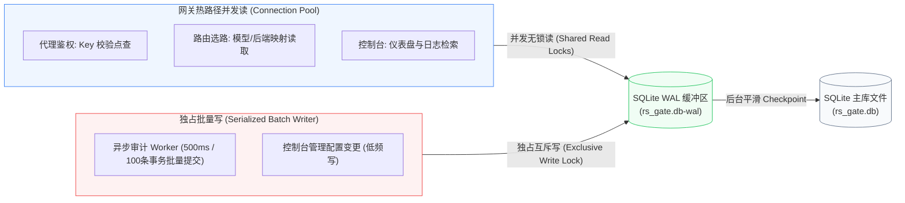
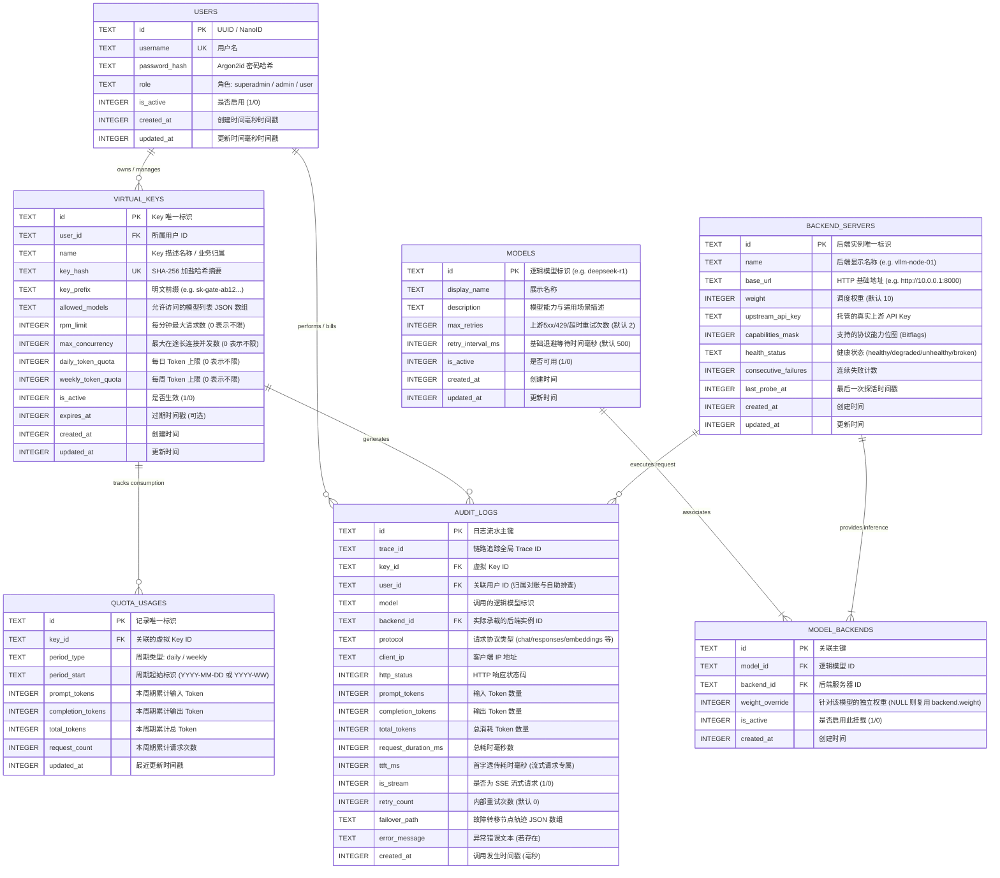
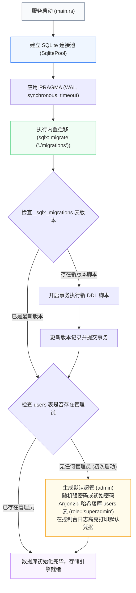
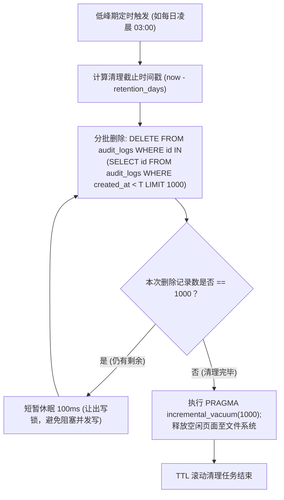

# rs-gate 存储架构与数据模型规范 (Storage Architecture & Data Models)

- **文档编号**：`02-storage-and-models.md`
- **文档版本**：`v1.0.0`
- **编制日期**：2026-10-18
- **当前阶段**：阶段二：系统架构设计 (第 2 步：存储与模型篇)
- **基准依赖**：[`docs/01-features/01-feature-matrix.md`](file:///home/fugui/rusts/rs-gate/docs/01-features/01-feature-matrix.md), [`docs/02-design/01-system-architecture.md`](file:///home/fugui/rusts/rs-gate/docs/02-design/01-system-architecture.md)
- **状态**：定稿待审 (Ready for Review)

---

## 1. 存储架构愿景与技术边界 (Storage Vision & Boundaries)

### 1.1 系统定位与单二进制存储红线
根据 [`AGENTS.md`](file:///home/fugui/rusts/rs-gate/AGENTS.md) 与阶段一特性矩阵（[`01-feature-matrix.md`](file:///home/fugui/rusts/rs-gate/docs/01-features/01-feature-matrix.md)），rs-gate 坚守**单二进制、零外部中间件依赖**的架构红线。系统坚决不外挂 MySQL、PostgreSQL 或 Redis。

所有网关业务元数据（用户凭据、虚拟 Key、模型与物理后端集群拓扑、日/周配额状态）及调用审计明细均由**内嵌式 SQLite WAL 存储引擎**直接承载。

### 1.2 SQLite WAL 引擎与并发性能调优
SQLite 默认的回滚日志（Rollback Journal）模式在写操作时会阻塞所有读操作，无法满足高并发网关的读写性能需求。rs-gate 全面启用 **WAL (Write-Ahead Logging)** 模式，实现**并发多读者与单写者互不阻塞**（Concurrent Readers & Single Writer）。



#### 关键 PRAGMA 参数配置规范
网关在初始化 SQLx SQLite 连接池时，必须强制对所有物理连接注入以下 PRAGMA 调优参数：

```sql
-- 启用 WAL 预写日志模式，支持读写并发
PRAGMA journal_mode = WAL;

-- 权衡耐久性与 I/O 性能，WAL 模式下 NORMAL 可有效防止断电损坏且性能极佳
PRAGMA synchronous = NORMAL;

-- 设置写锁等待超时为 5000ms，杜绝高并发写入时抛出 database is locked 错误
PRAGMA busy_timeout = 5000;

-- 启用内存缓存 (-64000 表示分配约 64MB 内存页面缓存)
PRAGMA cache_size = -64000;

-- 严格启用外键约束完整性校验
PRAGMA foreign_keys = ON;

-- 启用增量空间回收模式 (Incremental Vacuum)，便于定时释放历史删除数据占用的磁盘空间
PRAGMA auto_vacuum = INCREMENTAL;

-- 临时表与临时索引优先存放于内存中
PRAGMA temp_store = MEMORY;
```

---

## 2. 实体关系模型全景 (Entity Relationship Diagram)

rs-gate 的物理数据模型紧密贴合企业级大模型网关的业务实体：



---

## 3. 物理数据建模与完整 DDL 规范 (Physical Data Models & Executable DDL)

以下为符合生产标准的完整 SQL DDL。该脚本将被固化在 `migrations/20261018000000_init.sql` 中，由系统的启动自迁移机制加载。

```sql
-- ============================================================================
-- rs-gate 基础数据库迁移脚本: 20261018000000_init.sql
-- 适用引擎: SQLite 3.35+ (WAL 模式)
-- ============================================================================

-- 1. 用户账户表 (users) - 统一管理超管、管理员与普通开发者用户
CREATE TABLE IF NOT EXISTS users (
    id TEXT PRIMARY KEY NOT NULL,
    username TEXT NOT NULL UNIQUE,
    password_hash TEXT NOT NULL,
    role TEXT NOT NULL DEFAULT 'user', -- 'superadmin' | 'admin' | 'user'
    is_active INTEGER NOT NULL DEFAULT 1,
    created_at INTEGER NOT NULL,
    updated_at INTEGER NOT NULL
);

-- 2. 虚拟 API Key 表 (virtual_keys)
CREATE TABLE IF NOT EXISTS virtual_keys (
    id TEXT PRIMARY KEY NOT NULL,
    user_id TEXT NOT NULL,
    name TEXT NOT NULL,
    key_hash TEXT NOT NULL UNIQUE,
    key_prefix TEXT NOT NULL,
    allowed_models TEXT NOT NULL DEFAULT '["*"]',
    rpm_limit INTEGER NOT NULL DEFAULT 60,
    max_concurrency INTEGER NOT NULL DEFAULT 10,
    daily_token_quota INTEGER NOT NULL DEFAULT 0,
    weekly_token_quota INTEGER NOT NULL DEFAULT 0,
    is_active INTEGER NOT NULL DEFAULT 1,
    expires_at INTEGER,
    created_at INTEGER NOT NULL,
    updated_at INTEGER NOT NULL,
    FOREIGN KEY (user_id) REFERENCES users(id) ON DELETE CASCADE
);

-- 3. 日/周双周期配额累积表 (quota_usages)
CREATE TABLE IF NOT EXISTS quota_usages (
    id TEXT PRIMARY KEY NOT NULL,
    key_id TEXT NOT NULL,
    period_type TEXT NOT NULL, -- 'daily' | 'weekly'
    period_start TEXT NOT NULL, -- daily: '2026-10-18', weekly: '2026-W42'
    prompt_tokens INTEGER NOT NULL DEFAULT 0,
    completion_tokens INTEGER NOT NULL DEFAULT 0,
    total_tokens INTEGER NOT NULL DEFAULT 0,
    request_count INTEGER NOT NULL DEFAULT 0,
    updated_at INTEGER NOT NULL,
    FOREIGN KEY (key_id) REFERENCES virtual_keys(id) ON DELETE CASCADE,
    CONSTRAINT uq_key_period UNIQUE (key_id, period_type, period_start)
);

-- 4. 逻辑大模型定义表 (models)
CREATE TABLE IF NOT EXISTS models (
    id TEXT PRIMARY KEY NOT NULL, -- 如 "deepseek-r1", "qwen-2.5-72b"
    display_name TEXT NOT NULL,
    description TEXT NOT NULL DEFAULT '',
    max_retries INTEGER NOT NULL DEFAULT 2, -- 上游 5xx/429/超时重试次数
    retry_interval_ms INTEGER NOT NULL DEFAULT 500, -- 基础退避等待时间 (毫秒)
    is_active INTEGER NOT NULL DEFAULT 1,
    created_at INTEGER NOT NULL,
    updated_at INTEGER NOT NULL
);

-- 5. 物理后端服务器实例表 (backend_servers)
CREATE TABLE IF NOT EXISTS backend_servers (
    id TEXT PRIMARY KEY NOT NULL,
    name TEXT NOT NULL,
    base_url TEXT NOT NULL,
    weight INTEGER NOT NULL DEFAULT 10,
    upstream_api_key TEXT,
    capabilities_mask INTEGER NOT NULL DEFAULT 0,
    health_status TEXT NOT NULL DEFAULT 'healthy',
    consecutive_failures INTEGER NOT NULL DEFAULT 0,
    last_probe_at INTEGER,
    created_at INTEGER NOT NULL,
    updated_at INTEGER NOT NULL
);

-- 6. 模型与后端集群多对多关联映射表 (model_backends)
CREATE TABLE IF NOT EXISTS model_backends (
    id TEXT PRIMARY KEY NOT NULL,
    model_id TEXT NOT NULL,
    backend_id TEXT NOT NULL,
    weight_override INTEGER,
    is_active INTEGER NOT NULL DEFAULT 1,
    created_at INTEGER NOT NULL,
    FOREIGN KEY (model_id) REFERENCES models(id) ON DELETE CASCADE,
    FOREIGN KEY (backend_id) REFERENCES backend_servers(id) ON DELETE CASCADE,
    CONSTRAINT uq_model_backend UNIQUE (model_id, backend_id)
);

-- 7. 审计调用流水明细表 (audit_logs)
CREATE TABLE IF NOT EXISTS audit_logs (
    id TEXT PRIMARY KEY NOT NULL,
    trace_id TEXT NOT NULL,
    key_id TEXT NOT NULL,
    user_id TEXT, -- 冗余关联用户 ID，加速用户级自服务明细检索与账单聚合
    model TEXT NOT NULL,
    backend_id TEXT NOT NULL,
    protocol TEXT NOT NULL,
    client_ip TEXT NOT NULL,
    http_status INTEGER NOT NULL,
    prompt_tokens INTEGER NOT NULL DEFAULT 0,
    completion_tokens INTEGER NOT NULL DEFAULT 0,
    total_tokens INTEGER NOT NULL DEFAULT 0,
    request_duration_ms INTEGER NOT NULL,
    ttft_ms INTEGER,
    is_stream INTEGER NOT NULL DEFAULT 0,
    retry_count INTEGER NOT NULL DEFAULT 0, -- 内部重试次数 (默认 0)
    failover_path TEXT, -- 经历的后端实例转移链路 JSON 数组 (e.g. '["node-1","node-2"]')
    error_message TEXT,
    created_at INTEGER NOT NULL
);
```

---

## 4. 索引设计与查询性能优化 (Index Design & Query Optimization)

在大模型网关场景下，读取分为两类：
1. **纳秒/亚毫秒级核心热路径**：Key 鉴权查询、路由选路关系加载、日/周配额预检点查；
2. **毫秒级管理控制台检索**：海量审计流水筛选、分页检索、统计大盘汇总。

为确保在 **10 万级调用日志** 规模下分页查询响应时间 $\le 50\text{ms}$，设计如下专用索引：

```sql
-- ============================================================================
-- 核心索引定义
-- ============================================================================

-- 1. 鉴权与流控热路径索引
-- 虚拟 Key 哈希点查索引 (覆盖率 100%，内存常驻 B-Tree，单次查询 <= 0.05ms)
CREATE UNIQUE INDEX IF NOT EXISTS idx_virtual_keys_key_hash 
    ON virtual_keys(key_hash);

-- 虚拟 Key 用户归属检索索引 (支持用户控制台快速加载个人 Key 列表)
CREATE INDEX IF NOT EXISTS idx_virtual_keys_user_id 
    ON virtual_keys(user_id, created_at DESC);

-- 配额快速点查复合索引 (key_id + period_type + period_start 唯一约束自带)
CREATE INDEX IF NOT EXISTS idx_quota_usages_lookup 
    ON quota_usages(key_id, period_type, period_start);

-- 2. 路由选路热路径索引
-- 查找指定逻辑模型下的所有启用后端
CREATE INDEX IF NOT EXISTS idx_model_backends_model_active 
    ON model_backends(model_id, is_active);

-- 后端健康状态与能力筛选索引
CREATE INDEX IF NOT EXISTS idx_backend_servers_health 
    ON backend_servers(health_status, is_active);

-- 3. 审计日志高性能组合检索索引 (针对控制台 10 万级日志多维下钻)
-- 场景 A: 全局时间倒序分页 (最基础控制台流水分页)
CREATE INDEX IF NOT EXISTS idx_audit_logs_created_at_desc 
    ON audit_logs(created_at DESC);

-- 场景 B: 租户 Key 维度调用明细下钻与时间过滤
CREATE INDEX IF NOT EXISTS idx_audit_logs_key_created 
    ON audit_logs(key_id, created_at DESC);

-- 场景 B-2: 普通用户个人调用流水自助排查与账单对账
CREATE INDEX IF NOT EXISTS idx_audit_logs_user_created 
    ON audit_logs(user_id, created_at DESC);

-- 场景 C: 模型维度吞吐与消耗统计
CREATE INDEX IF NOT EXISTS idx_audit_logs_model_created 
    ON audit_logs(model, created_at DESC);

-- 场景 D: 全局唯一 Trace ID 精确点查追踪
CREATE INDEX IF NOT EXISTS idx_audit_logs_trace_id 
    ON audit_logs(trace_id);
```

### 4.1 控制台典型查询执行计划评估 (EXPLAIN QUERY PLAN)

针对管理控制台的高频查询语句，通过复合索引实现高效的 `INDEX SCAN`，杜绝全表扫描（`TABLE SCAN`）：

```sql
-- 验证查询 1: 检索特定 Key 在过去 24 小时内的调用记录，按时间倒序取前 20 条
EXPLAIN QUERY PLAN
SELECT id, trace_id, model, http_status, total_tokens, request_duration_ms, created_at
FROM audit_logs
WHERE key_id = 'key_123456' AND created_at >= 1729200000000
ORDER BY created_at DESC
LIMIT 20;

-- 预期执行计划输出:
-- SEARCH audit_logs USING INDEX idx_audit_logs_key_created (key_id=? AND created_at>?)

-- 验证查询 2: 普通开发者检索个人调用明细与报错排查 (基于 user_id 过滤)
EXPLAIN QUERY PLAN
SELECT id, trace_id, model, http_status, total_tokens, request_duration_ms, created_at
FROM audit_logs
WHERE user_id = 'user_123456' AND created_at >= 1729200000000
ORDER BY created_at DESC
LIMIT 20;

-- 预期执行计划输出:
-- SEARCH audit_logs USING INDEX idx_audit_logs_user_created (user_id=? AND created_at>?)

-- 验证查询 3: 个人用量大盘 - 聚合当前用户名下所有 Key 的本周 Token 累计消耗
EXPLAIN QUERY PLAN
SELECT 
    sum(qu.prompt_tokens) AS total_prompt,
    sum(qu.completion_tokens) AS total_completion,
    sum(qu.total_tokens) AS total_tokens,
    sum(qu.request_count) AS total_requests
FROM quota_usages qu
JOIN virtual_keys vk ON qu.key_id = vk.id
WHERE vk.user_id = 'user_123456' AND qu.period_type = 'weekly' AND qu.period_start = '2026-W42';

-- 预期执行计划输出:
-- SEARCH vk USING INDEX idx_virtual_keys_user_id (user_id=?)
-- SEARCH qu USING INDEX idx_quota_usages_lookup (key_id=? AND period_type=? AND period_start=?)
```

---

## 5. Rust 实体映射与 DAO 契约抽象规范 (Rust Entities & DAO Traits)

为保障与 SQLx 异步连接池的无缝对接，定义生产级强类型 Rust 实体模型与异步数据访问接口（DAO）。

### 5.1 核心数据实体定义 (Entities)

```rust
use serde::{Deserialize, Serialize};
use sqlx::FromRow;

/// 1. 用户账户实体 (包含系统超管、管理员与普通开发者用户)
#[derive(Debug, Clone, PartialEq, Eq, Serialize, Deserialize, FromRow)]
pub struct UserEntity {
    pub id: String,
    pub username: String,
    pub password_hash: String,
    pub role: String, // "superadmin" | "admin" | "user"
    pub is_active: i64,
    pub created_at: i64,
    pub updated_at: i64,
}

/// 2. 虚拟 API Key 实体
#[derive(Debug, Clone, PartialEq, Eq, Serialize, Deserialize, FromRow)]
pub struct VirtualKeyEntity {
    pub id: String,
    pub user_id: String, // 所属用户 ID
    pub name: String,
    pub key_hash: String,
    pub key_prefix: String,
    pub allowed_models: String, // 存储为 JSON 字符串
    pub rpm_limit: i64,
    pub max_concurrency: i64,
    pub daily_token_quota: i64,
    pub weekly_token_quota: i64,
    pub is_active: i64,
    pub expires_at: Option<i64>,
    pub created_at: i64,
    pub updated_at: i64,
}

/// 3. 日/周配额周期记录实体
#[derive(Debug, Clone, PartialEq, Eq, Serialize, Deserialize, FromRow)]
pub struct QuotaUsageEntity {
    pub id: String,
    pub key_id: String,
    pub period_type: String, // "daily" | "weekly"
    pub period_start: String, // "2026-10-18" | "2026-W42"
    pub prompt_tokens: i64,
    pub completion_tokens: i64,
    pub total_tokens: i64,
    pub request_count: i64,
    pub updated_at: i64,
}

/// 4. 逻辑模型实体
#[derive(Debug, Clone, PartialEq, Eq, Serialize, Deserialize, FromRow)]
pub struct ModelEntity {
    pub id: String,
    pub display_name: String,
    pub description: String,
    pub max_retries: i64,       // 上游 5xx/429/超时重试次数 (默认 2)
    pub retry_interval_ms: i64, // 基础退避等待时间 (默认 500ms)
    pub is_active: i64,
    pub created_at: i64,
    pub updated_at: i64,
}

/// 5. 物理后端服务器实体
#[derive(Debug, Clone, PartialEq, Eq, Serialize, Deserialize, FromRow)]
pub struct BackendServerEntity {
    pub id: String,
    pub name: String,
    pub base_url: String,
    pub weight: i64,
    pub upstream_api_key: Option<String>,
    pub capabilities_mask: i64,
    pub health_status: String,
    pub consecutive_failures: i64,
    pub last_probe_at: Option<i64>,
    pub created_at: i64,
    pub updated_at: i64,
}

/// 6. 模型与后端映射实体
#[derive(Debug, Clone, PartialEq, Eq, Serialize, Deserialize, FromRow)]
pub struct ModelBackendEntity {
    pub id: String,
    pub model_id: String,
    pub backend_id: String,
    pub weight_override: Option<i64>,
    pub is_active: i64,
    pub created_at: i64,
}

/// 7. 审计流水明细实体
#[derive(Debug, Clone, PartialEq, Eq, Serialize, Deserialize, FromRow)]
pub struct AuditLogEntity {
    pub id: String,
    pub trace_id: String,
    pub key_id: String,
    pub user_id: Option<String>, // 归属用户 ID (支持用户自服务对账与排查)
    pub model: String,
    pub backend_id: String,
    pub protocol: String,
    pub client_ip: String,
    pub http_status: i64,
    pub prompt_tokens: i64,
    pub completion_tokens: i64,
    pub total_tokens: i64,
    pub request_duration_ms: i64,
    pub ttft_ms: Option<i64>,
    pub is_stream: i64,
    pub retry_count: i64,        // 内部重试次数 (默认 0)
    pub failover_path: Option<String>, // 故障转移节点轨迹 JSON 数组
    pub error_message: Option<String>,
    pub created_at: i64,
}
```

### 5.2 核心 DAO 接口契约规范 (DAO Traits)

```rust
use async_trait::async_trait;
use crate::error::GatewayError;

/// 用户账户数据访问契约 (支持超管、管理员与普通开发者自服务)
#[async_trait]
pub trait UserDao: Send + Sync {
    async fn find_by_id(&self, user_id: &str) -> Result<Option<UserEntity>, GatewayError>;
    async fn find_by_username(&self, username: &str) -> Result<Option<UserEntity>, GatewayError>;
    async fn list_all(&self) -> Result<Vec<UserEntity>, GatewayError>;
    async fn create(&self, user: &UserEntity) -> Result<(), GatewayError>;
    async fn update(&self, user: &UserEntity) -> Result<(), GatewayError>;
    async fn delete(&self, user_id: &str) -> Result<(), GatewayError>;
}

/// 虚拟 Key 数据访问契约
#[async_trait]
pub trait VirtualKeyDao: Send + Sync {
    async fn find_by_hash(&self, key_hash: &str) -> Result<Option<VirtualKeyEntity>, GatewayError>;
    async fn find_by_id(&self, key_id: &str) -> Result<Option<VirtualKeyEntity>, GatewayError>;
    async fn list_by_user(&self, user_id: &str) -> Result<Vec<VirtualKeyEntity>, GatewayError>;
    async fn list_all(&self) -> Result<Vec<VirtualKeyEntity>, GatewayError>;
    async fn create(&self, key: &VirtualKeyEntity) -> Result<(), GatewayError>;
    async fn update(&self, key: &VirtualKeyEntity) -> Result<(), GatewayError>;
    async fn delete(&self, key_id: &str) -> Result<(), GatewayError>;
}

/// 配额使用量更新契约
#[async_trait]
pub trait QuotaUsageDao: Send + Sync {
    /// 原子增量累加指定周期内的 Token 消耗与请求数
    async fn increment_usage(
        &self,
        key_id: &str,
        period_type: &str,
        period_start: &str,
        prompt_tokens: i64,
        completion_tokens: i64,
        total_tokens: i64,
    ) -> Result<(), GatewayError>;

    /// 获取特定 Key 在指定周期的使用量统计
    async fn get_usage(
        &self,
        key_id: &str,
        period_type: &str,
        period_start: &str,
    ) -> Result<Option<QuotaUsageEntity>, GatewayError>;

    /// 手动清零重置指定 Key 的当前周期额度
    async fn reset_usage(
        &self,
        key_id: &str,
        period_type: &str,
        period_start: &str,
    ) -> Result<(), GatewayError>;
}

/// 审计流水批量落盘与多维筛选契约
#[derive(Debug, Default)]
pub struct AuditQueryFilter {
    pub key_id: Option<String>,
    pub user_id: Option<String>, // 支持普通用户按自身 ID 筛选个人调用流水
    pub model: Option<String>,
    pub protocol: Option<String>,
    pub http_status: Option<u16>,
    pub start_time: Option<i64>,
    pub end_time: Option<i64>,
    pub offset: u32,
    pub limit: u32,
}

#[async_trait]
pub trait AuditLogDao: Send + Sync {
    /// 批量高效写入审计记录（用于异步 Worker 500ms 批量事务提交）
    async fn insert_batch(&self, logs: &[AuditLogEntity]) -> Result<(), GatewayError>;

    /// 控制台多维筛选与分页检索
    async fn query_logs(&self, filter: &AuditQueryFilter) -> Result<(Vec<AuditLogEntity>, u64), GatewayError>;

    /// TTL 滚动清理：删除早于指定时间戳的过期记录
    async fn delete_before(&self, timestamp_ms: i64) -> Result<u64, GatewayError>;
}

/// 模型与后端集群拓扑查询契约
#[async_trait]
pub trait TopologyDao: Send + Sync {
    /// 查询指定模型绑定的所有可用后端及权重
    async fn get_backends_for_model(&self, model_id: &str) -> Result<Vec<(BackendServerEntity, i64)>, GatewayError>;
    /// 获取全量模型配置
    async fn list_models(&self) -> Result<Vec<ModelEntity>, GatewayError>;
    /// 更新后端探活状态与能力位图
    async fn update_backend_probe_status(
        &self,
        backend_id: &str,
        status: &str,
        capabilities_mask: i64,
        probe_at: i64,
    ) -> Result<(), GatewayError>;
}
```

---

## 6. 声明式迁移体系与自初始化机制 (Declarative Migrations & Auto-Initialization)

为了保障系统**初次启动即用、无须手动执行 DDL**，rs-gate 采用编译期打包的声明式版本迁移方案。



### 6.1 `migrations/` 目录组织规范
所有数据库变更必须通过声明式 SQL 脚本管理，禁止在业务代码中内嵌 `CREATE TABLE` 字符串：

```text
migrations/
├── 20261018000000_init.sql          # 初始表结构、外键与核心复合索引
└── 20261025000000_add_feature_x.sql # 后续版本演进迁移（追加迁移）
```

### 6.2 迁移执行器与自初始化代码规范

```rust
use sqlx::sqlite::{SqliteConnectOptions, SqlitePoolOptions};
use sqlx::{Pool, Sqlite};
use std::path::Path;
use std::str::FromStr;
use tracing::{info, warn};
use crate::error::GatewayError;

pub struct DatabaseManager {
    pool: Pool<Sqlite>,
}

impl DatabaseManager {
    /// 初始化连接池并自执行声明式迁移
    pub async fn initialize(db_path: &str) -> Result<Self, GatewayError> {
        let connection_options = SqliteConnectOptions::from_str(&format!("sqlite://{}", db_path))
            .map_err(|e| GatewayError::DatabaseError(e.to_string()))?
            .create_if_missing(true)
            .journal_mode(sqlx::sqlite::SqliteJournalMode::Wal)
            .synchronous(sqlx::sqlite::SqliteSynchronous::Normal)
            .busy_timeout(std::time::Duration::from_secs(5));

        let pool = SqlitePoolOptions::new()
            .max_connections(20)
            .min_connections(2)
            .acquire_timeout(std::time::Duration::from_secs(5))
            .connect_with(connection_options)
            .await
            .map_err(|e| GatewayError::DatabaseError(format!("Failed to connect to SQLite: {}", e)))?;

        // 编译期内嵌 migrations 目录下的全部迁移脚本
        info!("Running declarative database migrations...");
        sqlx::migrate!("./migrations")
            .run(&pool)
            .await
            .map_err(|e| GatewayError::DatabaseError(format!("Migration failed: {}", e)))?;
        info!("Database migrations executed successfully.");

        let manager = Self { pool };
        manager.ensure_default_admin().await?;

        Ok(manager)
    }

    /// 初次启动检测：若无任何管理员账户，则自动初始化默认超管
    async fn ensure_default_admin(&self) -> Result<(), GatewayError> {
        let count: (i64,) = sqlx::query_as("SELECT COUNT(*) FROM users WHERE role IN ('superadmin', 'admin')")
            .fetch_one(&self.pool)
            .await
            .map_err(|e| GatewayError::DatabaseError(e.to_string()))?;

        if count.0 == 0 {
            let default_username = "admin";
            // 生产环境下可由配置指定，未配置时生成安全随机密码
            let generated_password = "gate_admin_init_pass"; 
            let password_hash = crate::limiting::hash_admin_password(generated_password)?;

            let now = chrono::Utc::now().timestamp_millis();
            let admin_id = uuid::Uuid::new_v4().to_string();

            sqlx::query!(
                r#"
                INSERT INTO users (id, username, password_hash, role, is_active, created_at, updated_at)
                VALUES (?1, ?2, ?3, 'superadmin', 1, ?4, ?4)
                "#,
                admin_id,
                default_username,
                password_hash,
                now
            )
            .execute(&self.pool)
            .await
            .map_err(|e| GatewayError::DatabaseError(e.to_string()))?;

            warn!("============================================================");
            warn!(" Initialized default superadmin account: {}", default_username);
            warn!(" Initialized default superadmin password: {}", generated_password);
            warn!(" PLEASE CHANGE PASSWORD IMMEDIATELY IN CONSOLE! ");
            warn!("============================================================");
        }

        Ok(())
    }

    pub fn pool(&self) -> &Pool<Sqlite> {
        &self.pool
    }
}
```

---

## 7. 数据生命周期管理与 TTL 滚动清理 (Data Retention & Maintenance)

长期高吞吐运行可能导致 `audit_logs` 表无限制膨胀，耗尽磁盘空间。rs-gate 设计了后台轻量级 TTL 自动滚动维护机制。

### 7.1 分批清理与增量收缩机制 (Batch Deletion & Vacuum)
若一次性执行 `DELETE FROM audit_logs WHERE created_at < T`，当待删除记录数巨大时，将持有长事务写锁，可能导致主中继写入超时。

因此，TTL 清理采取**游标分批删除策略**：



### 7.2 定时任务参数与指标规范
- **默认保留周期**：`audit_retention_days = 30`（可通过配置文件修改）；
- **执行时间窗口**：每日凌晨 03:00 执行一次；
- **批次大小**：每批最多删除 1,000 条，批次间让渡 100ms 写锁间隔；
- **空闲页面回收**：调用 `PRAGMA incremental_vacuum`，在无需对整个数据库加排他重锁（FULL VACUUM）的前提下平滑回收存储。

---

## 8. 交付验证标准与下一步衔接 (Verification & Roadmap)

### 8.1 存储设计验收标准 (Storage Verification Checklist)

- [x] **架构合规性**：坚持 SQLite WAL 模式，单二进制本地存储，零外挂数据库（No Redis/Kafka/MySQL）。
- [x] **DDL 完备性**：给出 7 大核心业务实体表的规范 DDL，主外键约束、默认值与时间戳规范统一。
- [x] **索引覆盖度**：针对 Key 哈希鉴权点查、路由拓扑过滤及控制台多维筛选（10 万级日志 $\le 50\text{ms}$）设计了完整的复合索引体系。
- [x] **强类型契约**：定义了完整的 Rust 实体模型（`UserEntity`、`VirtualKeyEntity`、`AuditLogEntity` 等）与纯异步 DAO Trait。
- [x] **声明式迁移**：明确 `migrations/` 目录组织与 `sqlx::migrate!()` 编译期内嵌自初始化规范，包含首启动默认管理员创建。
- [x] **生命周期管理**：设计了低峰期分批清理（Batch Delete）与增量收缩（Incremental Vacuum）机制，杜绝长事务锁库。

### 8.2 下一步工作计划
本存储与模型设计规范定稿并提交后，将继续按照阶段二规划推进下一篇专题子文档：
👉 **编制阶段二第 3 步**：[`docs/02-design/03-routing-and-proxy.md`](file:///home/fugui/rusts/rs-gate/docs/02-design/03-routing-and-proxy.md)（【代理篇】多协议原生直通代理、加权最小活跃长连接调度算法、`ActiveConnectionGuard` RAII 防泄漏机制、低延迟 SSE 逐 Chunk 管道、Usage 增量解析与客户端 Abort 级联中断）。
