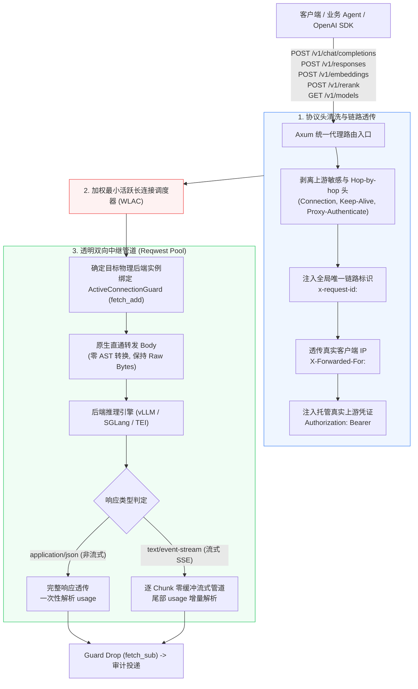
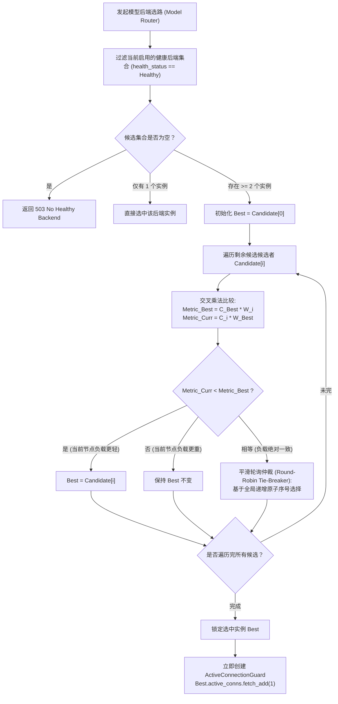
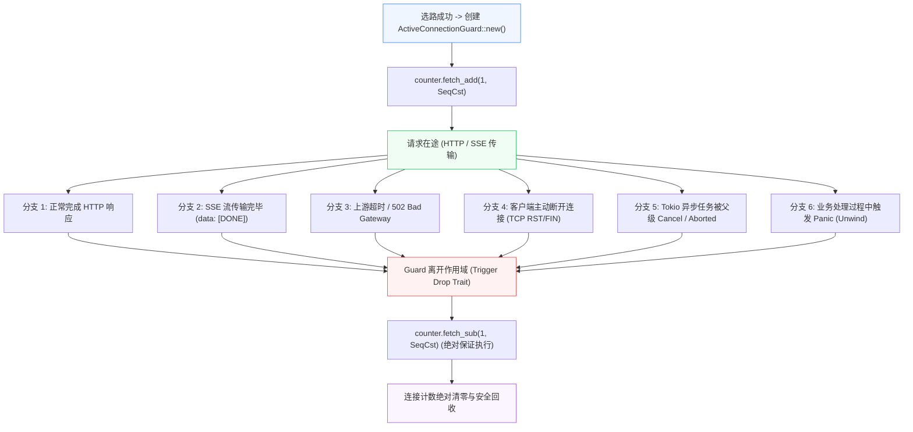
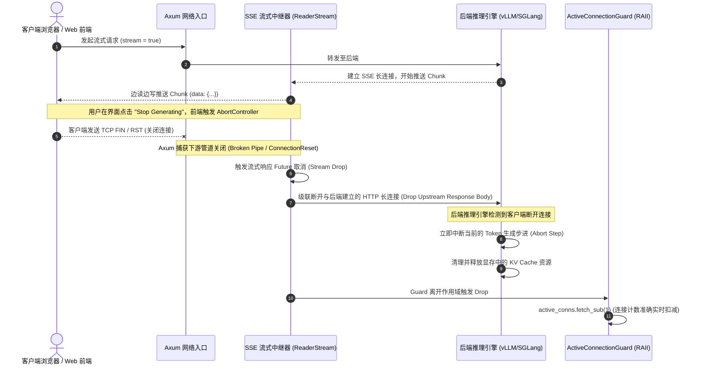
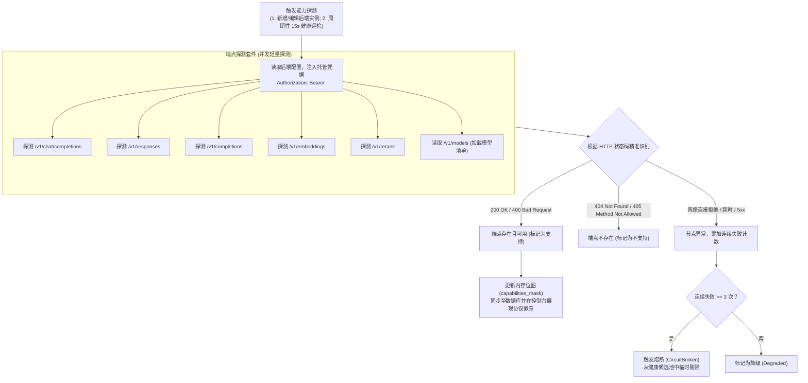

# rs-gate 核心调度与流式代理中继规范 (Routing & Proxy Engine)

- **文档编号**：`03-routing-and-proxy.md`
- **文档版本**：`v1.0.0`
- **编制日期**：2026-10-18
- **当前阶段**：阶段二：系统架构设计 (第 3 步：调度与代理篇)
- **基准依赖**：[`docs/01-features/01-feature-matrix.md`](file:///home/fugui/rusts/rs-gate/docs/01-features/01-feature-matrix.md), [`docs/02-design/01-system-architecture.md`](file:///home/fugui/rusts/rs-gate/docs/02-design/01-system-architecture.md)
- **状态**：定稿待审 (Ready for Review)

---

## 1. 架构愿景与调度挑战 (Vision & Core Challenges)

### 1.1 核心设计定位
在大模型企业网关中，中继代理与集群调度是决定系统吞吐、响应延迟与 GPU 资源利用率的核心命脉。网关定位为**高性能、低延迟的原生透明中继器**，坚持两大基本原则：
1. **零跨协议 AST 转换损耗**：不对请求与响应体做昂贵的多重反序列化与语义重构，保证网关处理开销 $P99 \le 1.5\text{ms}$；
2. **零缓冲 SSE 流式管道**：流式响应逐 Chunk 实时透传，首字透传附加延迟（TTFT Overhead）$\le 1\text{ms}$。

### 1.2 大模型请求特征与长短倾斜痛点 (The Imbalance Dilemma)
传统微服务网关通常采用轮询（Round-Robin）或请求数加权轮询。然而，大模型推理负载具有**极端的异构性与非对称性**：
- **短查询请求**：简单意图识别或短问答，几百毫秒即可生成几十个 Token 结束；
- **长深度思考请求**：复杂代码编写、Agent 多轮循环调用或 DeepSeek-R1 深度推理长思考，可能持续占用连接 30~90 秒并生成数万 Token，持续霸占 GPU 显存中的 KV Cache。

若采用常规的请求计数轮询，瞬时分配均等的请求会导致长连接随机聚集在少数节点，引发该节点的 GPU 显存 KV Cache 耗尽（OOM）、推理降速甚至雪崩。

因此，rs-gate 必须全面落地**基于实时在途长连接数的加权最小活跃连接调度算法 (Weighted Least-Active-Connections, WLAC)**，并配合 **RAII 连接泄漏终极防护** 与 **客户端 Abort 级联中断传导**。

---

## 2. 多协议原生直通中继架构 (Multi-Protocol Passthrough Architecture)



### 2.1 原生直通支持的端点矩阵

| 目标端点路径 | 请求方法 | 典型后端引擎 | 协议特征与网关处理策略 |
| :--- | :---: | :--- | :--- |
| `/v1/chat/completions` | `POST` | vLLM, SGLang, Ollama, OpenAI | 标准 Chat 协议，支持非流式 JSON 与流式 SSE；网关透明转发 Body，清洗鉴权头。 |
| `/v1/responses` | `POST` | OpenAI 新一代 Responses API, vLLM 兼容层 | OpenAI 新一代 Agentic Responses 端点；原生透传输入与多模态流，绝不做语义重写。 |
| `/v1/completions` | `POST` | vLLM, SGLang | 传统补全协议；直通转发。 |
| `/v1/embeddings` | `POST` | TEI (Text Embeddings Inference), vLLM | 向量嵌入协议；批量高频短请求，直通转发并提取输入 token 计量。 |
| `/v1/rerank` | `POST` | TEI, 专用 Reranker 服务 | 交叉编码器重排序协议；直通转发，透传重排文档得分。 |
| `/v1/models` | `GET` | 聚合网关内存模型表 | 聚合网关当前已启用的逻辑模型元数据列表并以标准 OpenAI 格式返回。 |

### 2.2 协议头清洗与凭证隔离规则
1. **剥离 Hop-by-hop 头**：强制清除 `connection`, `keep-alive`, `proxy-authenticate`, `proxy-authorization`, `te`, `trailers`, `transfer-encoding`, `upgrade` 等与单跳传输相关的头；
2. **链路追踪透传**：检查入站请求是否存在 `x-request-id`，若不存在则生成全局唯一 UUID，并将该 ID 同时注入给上游请求头与下游客户端响应头；
3. **真实客户端 IP 保留**：在 `X-Forwarded-For` 头末尾追加当前 TCP 远端 IP；
4. **后端凭据绝对屏蔽**：网关剥离客户端发送的 `Authorization: Bearer <virtual-key>`，代之以从数据库加载的该后端专用托管真实凭证 `upstream_api_key`。外部客户端绝不可探知后端物理鉴权信息。

---

## 3. 加权最小活跃长连接调度算法 (WLAC Engine)

### 3.1 数学模型与除法截断缺陷
设指定逻辑模型下挂载了 $N$ 个健康后端实例。对于实例 $i$：
- 其配置的调度权重为 $W_i$（正整数，默认 10）；
- 其当前在途活跃长连接数为 $C_i$（通过原子操作实时追踪）。

理想的负载比率定义为：
$$\text{LoadRatio}_i = \frac{C_i}{W_i}$$

调度器的目标是在所有健康实例中挑选 $\text{LoadRatio}_i$ 最小的节点。

#### ❌ 整数除法与浮点除法的灾难
- **整数除法截断**：若采用整数除法 $C_i / W_i$，当节点 $A$（$C_A=2, W_A=10$）与节点 $B$（$C_B=8, W_B=10$）比较时，由于截断两者结果均为 $0$！调度器无法感知节点 $B$ 负载已是节点 $A$ 的 4 倍，算法彻底退化为无效调度。
- **浮点除法开销与精度**：浮点除法指令周期长，且高并发下浮点比较存在不可控精度抖动。

### 3.2 无除法交叉乘法比较算法 (Division-Free Cross Multiplication)
rs-gate 严格采用**无除法交叉乘法比较**：
对于任意两个候选后端实例 $A$ 与 $B$，比对 $\frac{C_A}{W_A}$ 与 $\frac{C_B}{W_B}$ 严格等价于比对：
$$C_A \times W_B \quad \text{vs} \quad C_B \times W_A$$



### 3.3 算法 Rust 核心实现规范

```rust
use std::sync::atomic::{AtomicUsize, Ordering};
use std::sync::Arc;
use crate::error::GatewayError;
use crate::routing::instance::BackendInstance;
use crate::proxy::guard::ActiveConnectionGuard;

pub struct WlacScheduler {
    /// 负载相等时的平滑轮询全局计数器
    round_robin_counter: AtomicUsize,
}

impl WlacScheduler {
    pub fn new() -> Self {
        Self {
            round_robin_counter: AtomicUsize::new(0),
        }
    }

    /// 执行加权最小活跃长连接选路 (无除法交叉乘法)
    pub fn select_backend(
        &self,
        candidates: &[Arc<BackendInstance>],
    ) -> Result<(Arc<BackendInstance>, ActiveConnectionGuard), GatewayError> {
        if candidates.is_empty() {
            return Err(GatewayError::NoHealthyBackend("No active backend".to_string()));
        }

        if candidates.len() == 1 {
            let selected = candidates[0].clone();
            let guard = ActiveConnectionGuard::new(
                selected.active_connections.clone(),
                selected.id.clone(),
            );
            return Ok((selected, guard));
        }

        // 挑选交叉乘法指标最小的实例
        let mut best_idx = 0;
        let mut best_active = candidates[0].active_connections.load(Ordering::Relaxed) as u64;
        let mut best_weight = candidates[0].weight.max(1) as u64;

        // 用于平滑仲裁的相等节点收集
        let mut tie_indices = Vec::with_capacity(candidates.len());
        tie_indices.push(0);

        for (i, current) in candidates.iter().enumerate().skip(1) {
            let curr_active = current.active_connections.load(Ordering::Relaxed) as u64;
            let curr_weight = current.weight.max(1) as u64;

            // 核心交叉乘法: C_best * W_curr vs C_curr * W_best
            let metric_best = best_active * curr_weight;
            let metric_curr = curr_active * best_weight;

            if metric_curr < metric_best {
                // 当前节点比已选最佳节点负载更轻
                best_idx = i;
                best_active = curr_active;
                best_weight = curr_weight;
                tie_indices.clear();
                tie_indices.push(i);
            } else if metric_curr == metric_best {
                // 两者负载比率严格相同，记录到同负荷集合中
                tie_indices.push(i);
            }
        }

        // 若存在多个负载完全相同的最优节点，通过轮询仲裁破局
        let final_idx = if tie_indices.len() > 1 {
            let offset = self.round_robin_counter.fetch_add(1, Ordering::Relaxed);
            tie_indices[offset % tie_indices.len()]
        } else {
            best_idx
        };

        let selected = candidates[final_idx].clone();
        // 绑定 RAII Guard，立即原子自增，退出作用域或异常时必然自动自减
        let guard = ActiveConnectionGuard::new(
            selected.active_connections.clone(),
            selected.id.clone(),
        );

        Ok((selected, guard))
    }
}
```

---

## 4. RAII 活跃长连接泄漏终极防护 (ActiveConnectionGuard)

在高并发网络网关中，计数器泄漏是最隐蔽且致命的缺陷。一旦因为代码分支未覆盖、异步任务取消或未捕获的 Panic 导致 `active_conns` 只加不减，该节点将永远被调度器认为“负载过高”而被打入冷宫。

rs-gate 依托 Rust 的 **RAII (Resource Acquisition Is Initialization)** 机制，构建 `ActiveConnectionGuard`，杜绝任何可能导致泄漏的路径。



### 4.1 Guard 数据结构与 Drop 实现

```rust
use std::sync::atomic::{AtomicUsize, Ordering};
use std::sync::Arc;
use tracing::trace;

/// 活跃连接生命周期 RAII 守卫
#[derive(Debug)]
pub struct ActiveConnectionGuard {
    counter: Arc<AtomicUsize>,
    backend_id: String,
}

impl ActiveConnectionGuard {
    /// 创建守卫时即刻原子递增，确保后续任何失败均在守卫保护下
    pub fn new(counter: Arc<AtomicUsize>, backend_id: String) -> Self {
        let prev = counter.fetch_add(1, Ordering::SeqCst);
        trace!(backend_id = %backend_id, active_conns = prev + 1, "Active connection acquired");
        Self { counter, backend_id }
    }

    pub fn backend_id(&self) -> &str {
        &self.backend_id
    }
}

impl Drop for ActiveConnectionGuard {
    fn drop(&mut self) {
        let prev = self.counter.fetch_sub(1, Ordering::SeqCst);
        trace!(backend_id = %self.backend_id, active_conns = prev.saturating_sub(1), "Active connection released via RAII");
    }
}
```

---

## 5. 客户端主动取消 (Client Abort) 级联中断机制

在 LLM 应用中，客户端取消生成（例如用户在前端点击“停止回答”或刷新页面）是非常高频的动作。如果网关在客户端断连后依然继续从后端接收推理 Chunk，会导致：
1. 后端 vLLM / SGLang 无法感知下游客户端已断开，继续调度 GPU 推理计算后续几千 Token；
2. GPU 显存中的 KV Cache 得不到释放，造成严重的无谓计算与电费损耗。

### 5.1 级联中断时序规范



### 5.2 异步取消传导实现代码规范

```rust
use axum::body::Body;
use axum::response::Response;
use futures_util::StreamExt;
use reqwest::Response as ReqwestResponse;
use tokio_util::sync::CancellationToken;
use tracing::{info, warn};
use crate::proxy::guard::ActiveConnectionGuard;

/// 构建支持客户端断连主动取消的 SSE 响应流
pub fn create_abortable_sse_stream(
    upstream_response: ReqwestResponse,
    guard: ActiveConnectionGuard,
    cancel_token: CancellationToken,
) -> Response {
    let mut byte_stream = upstream_response.bytes_stream();

    // 采用 async_stream 将上游输入转换为下游输出流
    let sse_stream = async_stream::stream! {
        // 将 guard 的所有权移入流式生成器内部
        // 当流正常结束、异常报错、或下游断开导致该 Generator 被 Drop 时，guard 必然被 Drop！
        let _guard = guard;

        loop {
            tokio::select! {
                // 监听外部主动取消信号
                _ = cancel_token.cancelled() => {
                    info!("SSE stream cancelled by cancellation token");
                    break;
                }
                // 从上游读取下一个字节 chunk
                chunk_result = byte_stream.next() => {
                    match chunk_result {
                        Some(Ok(bytes)) => {
                            yield Ok::<_, axum::Error>(bytes);
                        }
                        Some(Err(err)) => {
                            warn!("Upstream stream reading error: {}", err);
                            yield Err(axum::Error::new(err));
                            break;
                        }
                        None => {
                            // 上游正常输出完毕
                            break;
                        }
                    }
                }
            }
        }
    };

    Response::builder()
        .header(axum::http::header::CONTENT_TYPE, "text/event-stream")
        .header(axum::http::header::CACHE_CONTROL, "no-cache")
        .header(axum::http::header::CONNECTION, "keep-alive")
        .body(Body::from_stream(sse_stream))
        .unwrap()
}
```

---

## 6. 零缓冲 SSE 流式管道与增量 Usage 计量 (Zero-Buffer SSE & Usage Parsing)

### 6.1 逐 Chunk 零缓冲流式管道
传统网关若在中间层对 SSE 响应进行整包缓存（如先缓存到 `String` 再过滤），会导致首字透传延迟（TTFT）急剧飙升，严重劣化用户体验。

rs-gate 坚持**逐 Chunk 零缓冲透明流水线**：
1. 上游 Reqwest 返回的 `BytesStream` 直接对接 Axum 的 `Body::from_stream()`；
2. 内部零额外堆拷贝，上游推送多少字节，网关以非阻塞方式直透至下游 TCP Socket；
3. 首字延迟附加开销严格控制在 $P99 \le 1\text{ms}$。

### 6.2 增量 Usage 提取算法 (兼容 `stream_options.include_usage`)
OpenAI 兼容协议在客户端指定 `stream_options: {"include_usage": true}` 时，后端推理引擎会在最后一个数据 chunk 中返回调用消耗统计：

```text
data: {"id":"chatcmpl-123","choices":[],"usage":{"prompt_tokens":18,"completion_tokens":42,"total_tokens":60}}
data: [DONE]
```

#### 提取算法与状态机：
1. **轻量增量模式匹配**：绝不对所有 Chunk 做高开销的全量 JSON 反序列化。仅检查 chunk 中是否包含字节子串 `b"\"usage\":"`；
2. **快速反序列化**：仅当检测到子串时，才对当前单个 chunk 执行靶向轻量反序列化，提取 `prompt_tokens`、`completion_tokens` 与 `total_tokens`；
3. **Usage 缺失兜底机制**：若直到流结束均未提取到 Usage（如部分旧版后端端点未配置 `stream_options`），网关采取稳妥策略：
   - 记录 Token 为 0，并在审计日志中标记 `is_usage_missing = true`；
   - 依赖后续阶段引入的轻量级分词引擎（`tiktoken-rs`）在网关侧进行补偿估算（误差 $\le \pm 5\%$）。

```rust
use serde::Deserialize;

#[derive(Debug, Deserialize)]
struct SseChunkUsagePayload {
    usage: Option<TokenUsageRaw>,
}

#[derive(Debug, Deserialize)]
struct TokenUsageRaw {
    prompt_tokens: u32,
    completion_tokens: u32,
    total_tokens: u32,
}

pub struct StreamUsageExtractor;

impl StreamUsageExtractor {
    /// 高效靶向提取 chunk 中的 usage 块
    pub fn try_extract(chunk: &[u8]) -> Option<(u32, u32, u32)> {
        // 快速子串预检，99% 的文本 chunk 纳秒级直接跳过
        if !chunk.windows(8).any(|w| w == b"\"usage\":") {
            return None;
        }

        // 仅对命中包含 usage 关键字的 chunk 尝试 JSON 提取
        // 剥离开头的 "data: " 前缀
        let trimmed = if chunk.starts_with(b"data: ") {
            &chunk[6..]
        } else {
            chunk
        };

        if let Ok(payload) = serde_json::from_slice::<SseChunkUsagePayload>(trimmed) {
            if let Some(usage) = payload.usage {
                return Some((usage.prompt_tokens, usage.completion_tokens, usage.total_tokens));
            }
        }

        None
    }
}
```

### 6.3 流式场景日/周配额准入与透支防范策略
大模型流式请求在建立连接时**无法预知将生成多少 Token**。为防范恶意滥用导致超额透支，网关推行两道流式配额防线：
1. **准入门槛预留门限 (MinReserve)**：
   - 请求发起时，网关比对当前周期的剩余额度：
     $$Q_{\text{remain}} = Q_{\text{quota}} - \text{Used}$$
   - 若 $Q_{\text{remain}} < \text{MinReserve}$（默认保留 500 Token），则在建联阶段即刻硬阻断，返回 `429 Quota Exceeded`，杜绝配额已临界时继续放行巨型生成；
2. **生成后即时结算**：
   - SSE 响应完成并提取到真实 Token 消耗后，异步 Worker 即刻累加实际消耗至 `quota_usages` 表；若实际消耗使总额度超限，则下一次请求将被毫秒级拦截。

---

## 7. 后端服务器集群与协议能力预先探测 (Backend Capability Probing)

### 7.1 探测触发与凭证注入机制
网关必须在内存中掌握后端节点的真实协议支持情况，避免将 `/v1/responses` 或 `/v1/rerank` 请求错误分发给不支持该端点的后端实例。



### 7.2 状态判定规则与精准状态码区分
大模型推理后端对未携带参数的轻量探测请求通常返回 `400 Bad Request`（如缺失 `messages` 字段），这恰恰证明该端点是**存在且正常提供服务的**！探测器遵循以下严格判定标准：
- **支持 (Supported)**：HTTP 状态码为 `200`、`201`、`400`（参数校验错误）或 `422`；
- **不支持 (Unsupported)**：HTTP 状态码为 `404 Not Found` 或 `405 Method Not Allowed`；
- **异常故障 (Unhealthy)**：TCP 连接超时、连接重置或返回 `500/502/503/504`。

---

## 8. 交付验证标准与下一步衔接 (Verification & Roadmap)

### 8.1 代理与调度设计验收标准 (Verification Checklist)

- [x] **直通契约清晰**：覆盖 `/v1/chat/...`、`/v1/responses`、`/v1/completions`、`/v1/embeddings`、`/v1/rerank` 与 `/v1/models`，坚持零 AST 转换。
- [x] **无除法加权调度**：落实基于加权最小活跃连接（WLAC）的无除法交叉乘法算法（$C_A \times W_B \text{ vs } C_B \times W_A$），包含同负荷平滑轮询仲裁。
- [x] **RAII 连接泄漏防护**：`ActiveConnectionGuard` 规范设计，通过 `Drop` trait 实现全生命周期强制释放计数。
- [x] **客户端 Abort 级联中断**：设计完整的端到端异步取消传导时序，杜绝 GPU 显存 KV Cache 浪费。
- [x] **零缓冲 SSE 管道**：基于字节流实现边读边写透传，首字透传附加延迟 $\le 1\text{ms}$，提供轻量增量 Usage 解析器。
- [x] **协议能力预探测**：定义精准区分 200/400 与 404/405 的探测逻辑与健康状态机转换规则。

### 8.2 下一步工作计划
本代理与调度设计规范定稿并提交后，将继续按照阶段二规划推进最后 1 篇专业子文档：
👉 **编制阶段二第 4 步**：[`docs/02-design/04-limiting-and-audit.md`](file:///home/fugui/rusts/rs-gate/docs/02-design/04-limiting-and-audit.md)（【流控与审计篇】虚拟 Key 鉴权脱敏、无锁原子令牌桶 RPM、并发在途门限、日/周双层配额阻断与自动重置、Tokio mpsc 异步落盘流水线）。
