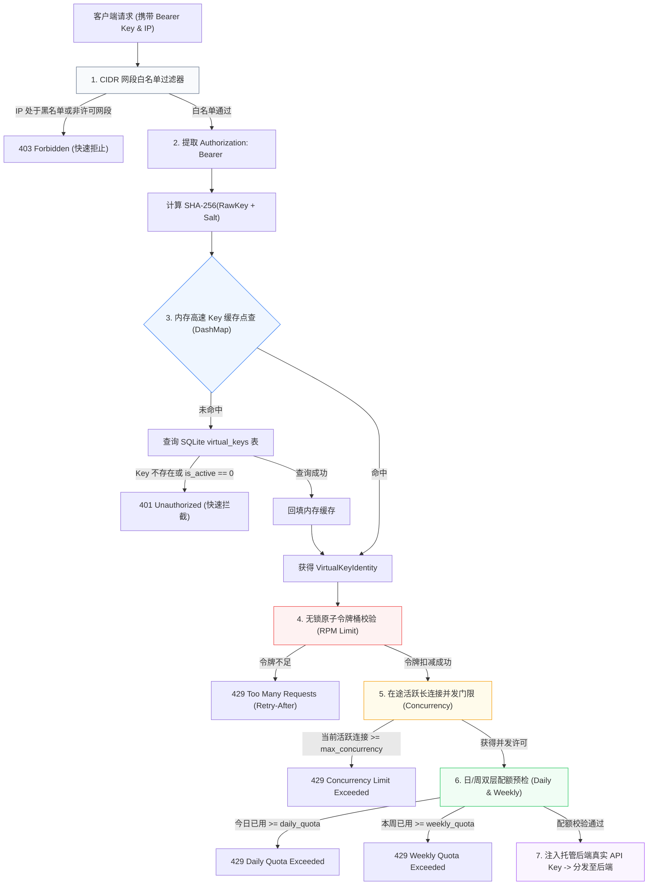
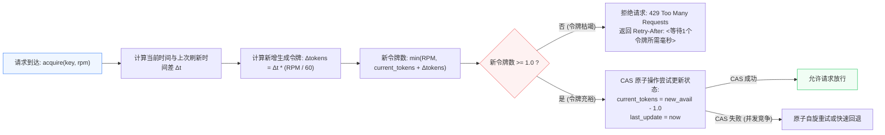
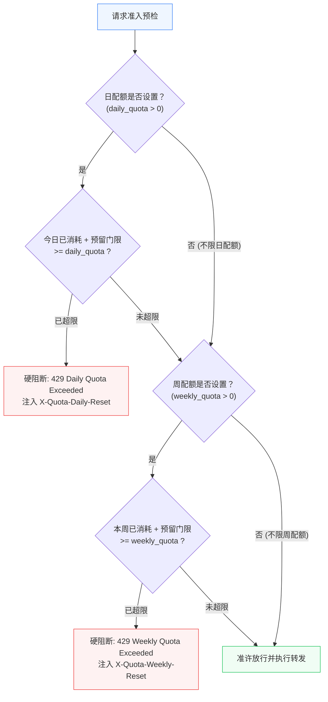
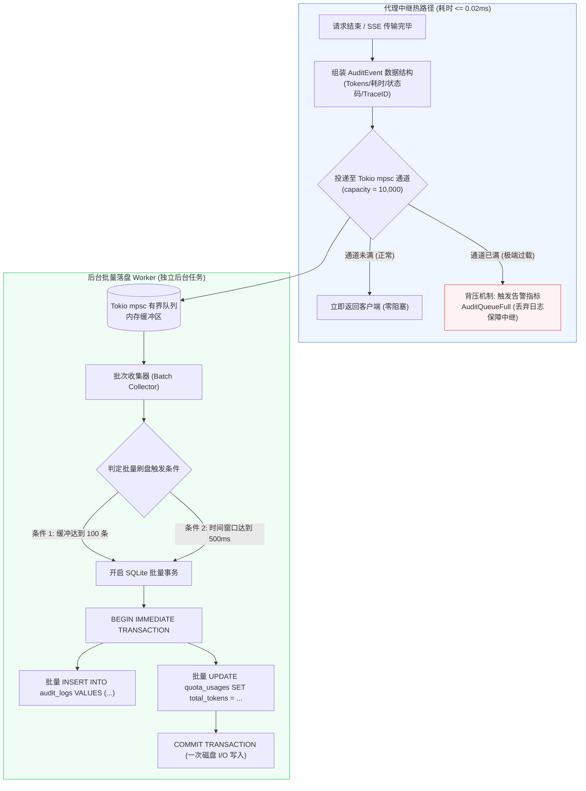

# rs-gate 流控安全与异步审计存储管道规范 (Limiting & Audit Pipeline)

- **文档编号**：`04-limiting-and-audit.md`
- **文档版本**：`v1.0.0`
- **编制日期**：2026-10-18
- **当前阶段**：阶段二：系统架构设计 (第 4 步：流控与审计篇)
- **基准依赖**：[`docs/01-features/01-feature-matrix.md`](file:///home/fugui/rusts/rs-gate/docs/01-features/01-feature-matrix.md), [`docs/02-design/01-system-architecture.md`](file:///home/fugui/rusts/rs-gate/docs/02-design/01-system-architecture.md)
- **状态**：定稿待审 (Ready for Review)

---

## 1. 架构愿景与安全准则 (Vision & Security Principles)

### 1.1 系统定位
在大模型网关的运行环境中，安全流控与审计管道构成了企业资产与 GPU 算力的核心防线。rs-gate 坚持三大核心原则：
1. **纳秒级快速鉴权与无锁流控**：在请求接触后端推理引擎之前，完成 CIDR 过滤、Key 身份认证、RPM 令牌桶与在途并发校验，判定延迟控制在 $\le 0.2\text{ms}$；
2. **企业级两层配额防线 (Daily & Weekly Quotas)**：日配额防止单日突发滥用，周配额控制业务部门累积消耗，超额即刻硬拦截；
3. **零阻塞异步审计落盘**：通过 Tokio mpsc 有界队列完全解耦代理热路径与磁盘 I/O，磁盘写入抖动绝不反向传导至流式代理中继。

---

## 2. 多层安全防线与凭证隔离架构 (Multi-Layer Security Architecture)



### 2.1 凭证隔离与脱敏规范
1. **虚拟 API Key 格式规范**：网关向业务侧分发的虚拟 Key 统一采用前缀加随机熵编码：
   `sk-gate-` + `32 位安全随机字符`（例如 `sk-gate-7a8f9b2c3d4e5f6a7b8c9d0e1f2a3b4c`）；
2. **加盐哈希持久化**：数据库中严禁明文持久化任何虚拟 Key。仅保存其 SHA-256 加盐哈希摘要（`key_hash`）与脱敏前缀（`key_prefix`，如 `sk-gate-7a8f...`，仅供控制台展示识别）；
3. **物理后端真实凭据屏蔽**：外部业务系统调用网关时使用虚拟 Key，网关在转发至底层物理后端（如 vLLM、SGLang 或第三方提供商）时，在内存中动态提取该后端配置的 `upstream_api_key` 并重写 `Authorization` 头。外部客户端绝对无法探知后端真实物理凭据。

---

## 3. 无锁原子令牌桶限流与并发控制 (Lock-Free Rate Limiting & Concurrency)

为满足网关 $10,000+\text{ RPS}$ 的吞吐需求，限流与并发控制路径严禁使用粗粒度互斥锁（`std::sync::Mutex`）。

### 3.1 无锁原子令牌桶 (Token Bucket) 数学模型
每个虚拟 Key 在内存中维护一个独立的无锁令牌桶结构：
- 容量上限：$C = \text{rpm\_limit}$；
- 填充速率：$R = \frac{C}{60.0} \text{ tokens/second}$；
- 状态维护：记录上一次填充时间戳 $T_{\text{last}}$ 与当前可用令牌数 $T_{\text{avail}}$。



### 3.2 令牌桶核心 Rust 实现

```rust
use std::sync::atomic::{AtomicU64, Ordering};
use std::time::Instant;
use crate::error::GatewayError;

/// 无锁原子令牌桶
/// 采用单个 AtomicU64 压缩存储或分离原子结构维护纳秒级状态
pub struct AtomicTokenBucket {
    /// 最近一次刷新时间（相对于进程启动的毫秒数）
    last_update_millis: AtomicU64,
    /// 当前可用令牌数（存储为以 1000 为比例尺的定点整数，支持亚浮点精度）
    available_tokens_scaled: AtomicU64,
    /// 进程基准时间戳
    base_instant: Instant,
}

impl AtomicTokenBucket {
    pub fn new(capacity: u32) -> Self {
        Self {
            last_update_millis: AtomicU64::new(0),
            available_tokens_scaled: AtomicU64::new((capacity as u64) * 1000),
            base_instant: Instant::now(),
        }
    }

    /// 尝试原子消费 1 个令牌
    pub fn try_acquire(&self, rpm: u32) -> Result<(), GatewayError> {
        if rpm == 0 {
            // RPM 为 0 表示不限流
            return Ok(());
        }

        let now_millis = self.base_instant.elapsed().as_millis() as u64;
        let capacity_scaled = (rpm as u64) * 1000;
        // 每毫秒生成的定点令牌数 = (rpm * 1000) / 60000 = (rpm) / 60
        let fill_rate_per_ms = (rpm as f64) / 60.0;

        let mut current_last_time = self.last_update_millis.load(Ordering::Relaxed);
        let mut current_tokens = self.available_tokens_scaled.load(Ordering::Relaxed);

        loop {
            let delta_ms = now_millis.saturating_sub(current_last_time);
            let added_tokens = ((delta_ms as f64) * fill_rate_per_ms) as u64;
            let total_available = (current_tokens + added_tokens).min(capacity_scaled);

            // 检查是否有至少 1 个令牌 (1000 scaled)
            if total_available < 1000 {
                return Err(GatewayError::RpmLimitExceeded);
            }

            let next_tokens = total_available - 1000;

            // 双原子 CAS 同步尝试
            if self.available_tokens_scaled.compare_exchange_weak(
                current_tokens,
                next_tokens,
                Ordering::SeqCst,
                Ordering::Relaxed,
            ).is_ok() {
                self.last_update_millis.store(now_millis, Ordering::Relaxed);
                return Ok(());
            }

            // 竞争失败，重新加载状态自旋
            current_last_time = self.last_update_millis.load(Ordering::Relaxed);
            current_tokens = self.available_tokens_scaled.load(Ordering::Relaxed);
        }
    }
}
```

### 3.3 在途并发长连接门限控制 (Concurrency Limiter)
每个虚拟 Key 还具备独立的并发控制：

```rust
use std::sync::atomic::{AtomicUsize, Ordering};
use std::sync::Arc;
use crate::error::GatewayError;

/// 在途长连接并发守卫 (RAII)
pub struct KeyConcurrencyGuard {
    counter: Arc<AtomicUsize>,
}

impl KeyConcurrencyGuard {
    pub fn try_acquire(counter: Arc<AtomicUsize>, max_concurrency: usize) -> Result<Self, GatewayError> {
        if max_concurrency == 0 {
            // 0 表示不限制并发
            return Ok(Self { counter });
        }

        let mut current = counter.load(Ordering::Relaxed);
        loop {
            if current >= max_concurrency {
                return Err(GatewayError::ConcurrencyLimitExceeded(max_concurrency));
            }

            match counter.compare_exchange_weak(
                current,
                current + 1,
                Ordering::SeqCst,
                Ordering::Relaxed,
            ) {
                Ok(_) => return Ok(Self { counter }),
                Err(actual) => current = actual,
            }
        }
    }
}

impl Drop for KeyConcurrencyGuard {
    fn drop(&mut self) {
        self.counter.fetch_sub(1, Ordering::SeqCst);
    }
}
```

---

## 4. 企业级日/周双层配额拦截与自动轮转 (Daily & Weekly Quotas System)

### 4.1 为什么必须实行日/周两级配额
在企业大模型使用场景中，仅依靠单一时间维度的配额存在严重的业务漏洞：
- **仅设月配额**：某个业务部门如果写出死循环 Agent，可能在 1 小时内将全月几十万 Token 配额刷空，导致后续整月业务停摆；
- **仅设日配额**：无法对周度或项目阶段性预算进行总量控制。

rs-gate 独创**日/周双层配额协同拦截机制**：



### 4.2 配额周期定义与对齐算法
- **时区标准**：配额周期严格按照系统配置的时区（默认 `Asia/Shanghai` 或 UTC+8）对齐；
- **日周期 Key 规范**：`daily:<YYYY-MM-DD>`（例如 `daily:2026-10-18`）。每日 00:00:00 自动开启新日计数；
- **周周期 Key 规范**：`weekly:<YYYY-Www>`（例如 `weekly:2026-W42`）。每周一 00:00:00 自动开启新周计数；
- **重置倒计时计算**：
  - 日重置时间戳：当日 23:59:59.999 的毫秒时间戳；
  - 周重置时间戳：本周日 23:59:59.999 的毫秒时间戳。

### 4.3 响应头契约规范
当请求通过或被配额拦截时，网关在响应头中完整回传统计指标：

```http
HTTP/1.1 200 OK
X-Quota-Daily-Limit: 1000000
X-Quota-Daily-Remaining: 742150
X-Quota-Daily-Reset: 1729267199
X-Quota-Weekly-Limit: 5000000
X-Quota-Weekly-Remaining: 3410200
X-Quota-Weekly-Reset: 1729439999
```

---

## 5. 异步非阻塞审计存储管道 (Async Audit Pipeline)

在超高并发网关中，如果每次请求结束后都直接在代理线程中执行数据库 `INSERT`，磁盘 I/O 抖动将迅速占满 Tokio 工作线程，导致网关整体雪崩。

rs-gate 采用 **Tokio mpsc 有界通道 + 后台批量事务刷盘 Worker** 彻底解耦主路径。



### 5.1 审计事件定义与有界通道配置
- **通道容量**：有界深度默认设为 `10,000` 条事件；
- **内存占用**：单条 `AuditEvent` 约 1KB，队列满载内存开销约 $\approx 10\text{MB}$，极其微型；
- **背压隔离**：代理主路径采用 `try_send()`，绝不 `await` 阻塞。在极极端磁盘 I/O 挂死情况下，保障网关大模型中继转发核心功能不中断。

### 5.2 批量写入 Worker 核心实现规范

```rust
use tokio::sync::mpsc::{Receiver, Sender};
use tokio::time::{interval, Duration};
use sqlx::{Pool, Sqlite};
use tracing::{error, info, warn};
use crate::audit::event::AuditEvent;

pub struct AuditWorker {
    receiver: Receiver<AuditEvent>,
    db_pool: Pool<Sqlite>,
    batch_size: usize,
    flush_interval: Duration,
}

impl AuditWorker {
    pub fn new(
        receiver: Receiver<AuditEvent>,
        db_pool: Pool<Sqlite>,
        batch_size: usize,
        flush_interval_ms: u64,
    ) -> Self {
        Self {
            receiver,
            db_pool,
            batch_size,
            flush_interval: Duration::from_millis(flush_interval_ms),
        }
    }

    /// 后台主事件循环
    pub async fn run(mut self) {
        info!("Audit batch worker started.");
        let mut buffer = Vec::with_capacity(self.batch_size);
        let mut ticker = interval(self.flush_interval);

        loop {
            tokio::select! {
                // 周期性定时刷新窗口 (默认 500ms)
                _ = ticker.tick() => {
                    if !buffer.is_empty() {
                        self.flush_batch(&mut buffer).await;
                    }
                }
                // 接收到新的审计事件
                maybe_event = self.receiver.recv() => {
                    match maybe_event {
                        Some(event) => {
                            buffer.push(event);
                            if buffer.len() >= self.batch_size {
                                self.flush_batch(&mut buffer).await;
                            }
                        }
                        None => {
                            // 发送端全部关闭 (系统停机排空)
                            info!("Audit channel closed, flushing remaining {} events...", buffer.len());
                            if !buffer.is_empty() {
                                self.flush_batch(&mut buffer).await;
                            }
                            break;
                        }
                    }
                }
            }
        }
        info!("Audit batch worker exited safely.");
    }

    /// 批量事务写入 SQLite WAL
    async fn flush_batch(&self, buffer: &mut Vec<AuditEvent>) {
        if buffer.is_empty() {
            return;
        }

        let count = buffer.len();
        let mut tx = match self.db_pool.begin().await {
            Ok(tx) => tx,
            Err(e) => {
                error!("Failed to begin transaction for audit batch: {}", e);
                return;
            }
        };

        for event in buffer.drain(..) {
            // 1. 批量插入审计明细
            let insert_res = sqlx::query!(
                r#"
                INSERT INTO audit_logs (
                    id, trace_id, key_id, user_id, model, backend_id, protocol,
                    client_ip, http_status, prompt_tokens, completion_tokens,
                    total_tokens, request_duration_ms, ttft_ms, is_stream,
                    error_message, created_at
                ) VALUES (?1, ?2, ?3, ?4, ?5, ?6, ?7, ?8, ?9, ?10, ?11, ?12, ?13, ?14, ?15, ?16, ?17)
                "#,
                event.id,
                event.trace_id,
                event.key_id,
                event.user_id,
                event.model,
                event.backend_id,
                event.protocol_str,
                event.client_ip,
                event.http_status,
                event.usage.prompt_tokens,
                event.usage.completion_tokens,
                event.usage.total_tokens,
                event.duration_ms,
                event.ttft_ms,
                event.is_stream as i64,
                event.error_message,
                event.created_at_timestamp,
            )
            .execute(&mut *tx)
            .await;

            if let Err(e) = insert_res {
                error!("Failed to stage audit log insert: {}", e);
            }
        }

        // 提交批量事务
        if let Err(e) = tx.commit().await {
            error!("Failed to commit audit batch of {} records: {}", count, e);
        }
    }
}
```

---

## 6. 交付验证标准与下一步衔接 (Verification & Roadmap)

### 6.1 流控与审计设计验收标准 (Verification Checklist)

- [x] **鉴权安全合规**：虚拟 API Key 规范命名、SHA-256 加盐脱敏、物理后端真实 API Key 绝对屏蔽。
- [x] **无锁流控架构**：无锁原子令牌桶（RPM）与在途并发门限（Concurrency Guard），杜绝全局粗粒度锁竞争。
- [x] **日/周双层配额**：清晰定义日配额与周配额的判定、准入门槛预留、周期时间对齐与自动轮转机制。
- [x] **异步落盘流水线**：Tokio mpsc 有界队列解耦、500ms / 100 条批量事务提交、背压隔离策略与优雅停机排空。
- [x] **强类型契约**：提供完整的 Rust 结构体与核心 Trait 代码，杜绝伪代码。

### 6.2 阶段二（系统架构设计）圆满收官与阶段三衔接
至此，阶段二的 **4 篇核心系统架构设计文档已全部编制完成**：
1. [`docs/02-design/01-system-architecture.md`](file:///home/fugui/rusts/rs-gate/docs/02-design/01-system-architecture.md)（【总览篇】系统总体分层架构与生命周期时序）
2. [`docs/02-design/02-storage-and-models.md`](file:///home/fugui/rusts/rs-gate/docs/02-design/02-storage-and-models.md)（【存储篇】SQLite WAL 存储模型、DDL 与自迁移）
3. [`docs/02-design/03-routing-and-proxy.md`](file:///home/fugui/rusts/rs-gate/docs/02-design/03-routing-and-proxy.md)（【代理篇】多协议直通、加权调度、RAII 防护与流式中继）
4. [`docs/02-design/04-limiting-and-audit.md`](file:///home/fugui/rusts/rs-gate/docs/02-design/04-limiting-and-audit.md)（【流控与审计篇】安全鉴权、日周配额与异步批量审计）

下一步将按照 SDD 流水线正式迈入：
👉 **「阶段三：接口契约与任务分解」**：
- 编制网关与控制台接口契约：[`docs/03-api/01-gateway-api.md`](file:///home/fugui/rusts/rs-gate/docs/03-api/01-gateway-api.md) 与 [`docs/03-api/02-admin-api.md`](file:///home/fugui/rusts/rs-gate/docs/03-api/02-admin-api.md)；
- 编制 Milestone 任务拆解与自动化验收清单：[`docs/04-tasks/01-tasks.md`](file:///home/fugui/rusts/rs-gate/docs/04-tasks/01-tasks.md)。
