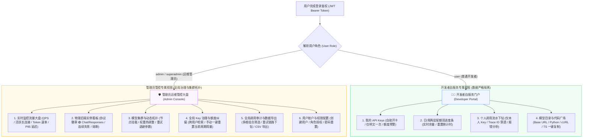
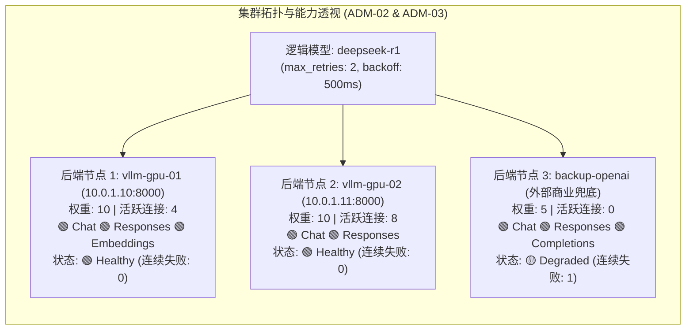
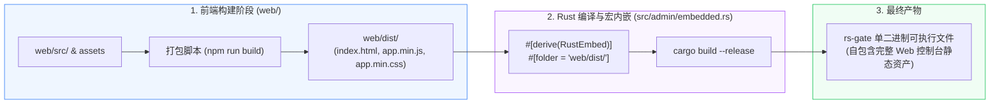

# rs-gate Web 控制台与自服务门户系统设计规范 (Web Console & Portal Architecture)

- **文档编号**：`05-web-console.md`
- **文档版本**：`v1.0.0`
- **编制日期**：2026-10-19
- **当前阶段**：阶段二：系统架构设计 (第 5 步：Web 控制台篇)
- **基准依赖**：[`docs/01-features/01-feature-matrix.md`](file:///home/fugui/rusts/rs-gate/docs/01-features/01-feature-matrix.md), [`docs/02-design/01-system-architecture.md`](file:///home/fugui/rusts/rs-gate/docs/02-design/01-system-architecture.md), [`docs/02-design/02-storage-and-models.md`](file:///home/fugui/rusts/rs-gate/docs/02-design/02-storage-and-models.md)
- **状态**：定稿待审 (Ready for Review)

---

## 1. 架构愿景与设计美学哲学 (Vision & Aesthetic Design Philosophy)

### 1.1 系统定位与工程使命
在企业大模型网关中，Web 控制台不仅仅是一个简单的管理后台，而是连接**算法运维团队（Ops/Admin）**与**企业内部业务研发团队（Developers）**的统一协同中枢与生产力门户。

rs-gate 坚定践行**单二进制交付（Single Binary Delivery）**与**零外部运行时依赖**的架构红线。Web 前端设计必须兼顾三大核心目标：
1. **极致轻量，零运行时开销**：不依赖笨重的大型前端框架运行时，编译产物压缩后控制在 $\le 2\text{MB}$，通过 Rust 宏直接嵌入二进制中，秒级启动且无任何 Node.js 外部服务器依赖；
2. **高端专业视觉质感 (Premium Aesthetics)**：打破传统开源工具粗糙的 MVP 风格，采用现代极简、定制 HSL 调色盘、深浅自适应暗黑主题、精致玻璃拟态（Glassmorphism）与丝滑微交互，呈现企业级旗舰产品的精致感；
3. **双视角业务闭环 (Dual-Perspective Ergonomics)**：清晰分离**“开发者自服务门户 (Developer Portal)”**与**“系统管理员运维大盘 (Ops Console)”**，让普通业务开发者直观自主管 Key、看配额、拷代码，让运维人员实时监控集群、热配权重与排查故障。

---

## 2. 双视角 RBAC 权限与视图动态适配体系 (Dual-Role & RBAC View Matrix)

系统实行严格的基于角色访问控制（RBAC），用户身份包含 `superadmin`（超级管理员）、`admin`（系统管理员）与 `user`（普通开发者）。



### 2.1 开发者自服务门户设计规范 (Developer Portal)

针对普通业务系统研发人员，门户提供极简、安全、自助式的接入与使用体验：

| 视图模块 | 核心功能与交互规范 | 关键数据指标 / 视觉呈现 |
| :--- | :--- | :--- |
| **我的 API Keys** | 1. 允许自主创建 Key，弹窗以高亮卡片形式展现生成的明文虚拟 Key，提示“此密钥仅展示一次，请妥善保存”，支持一键复制到剪贴板；<br>2. 密钥列表中仅展示加盐脱敏前缀（如 `sk-gate-7a8f...`）、允许模型列表、RPM 限流值及创建时间；<br>3. 支持自主停用或删除废弃 Key。 | 密钥明文弹窗、脱敏前缀徽章、状态切换开关 (Toggle)。 |
| **日/周配额双进度条** | 1. **今日已用额度**：展示今日已消耗 Token / 每日配额上限，带百分比与余量数值；<br>2. **本周已用额度**：展示本周累计已消耗 Token / 每周配额上限；<br>3. **自适应变色预警**：$< 70\%$ 显示清爽绿，$\ge 70\%$ 显示警告黄，$\ge 90\%$ 显示危险橙，达到 $100\%$ 显示阻断红并提示午夜自动重置倒计时。 | 动态双进度条（CSS Transition 平滑过渡）、配额重置倒计时时钟标签。 |
| **个人审计明细下钻** | 1. 仅能查看绑定于自身 API Key 的调用历史；<br>2. 列表字段包含：请求时间、Trace ID、调用模型、协议端点、HTTP 状态码、输入/输出 Token、首字延迟（TTFT）、总耗时；<br>3. 点击行展开下钻抽屉，展现完整请求元数据、内部重试次数（`retry_count`）与上游错误原因。 | 彩色 HTTP 状态徽章（200 绿、429 黄、5xx 红）、Trace ID 一键复制、报错详情抽屉。 |
| **模型广场与接入指南** | 1. 直观罗列企业已启用的逻辑模型列表（如 DeepSeek-R1、Qwen-2.5-72B、GLM-4 等），展示模型能力简介与上下文窗口；<br>2. **多语言接入代码生成器**：开发者选择自身使用的语言（Python OpenAI SDK、cURL、TypeScript/JavaScript Fetch），界面即时生成标准调用示例代码；<br>3. 代码自动预填当前网关的完整 Base URL 与所选模型 ID，一键复制即可运行。 | 选项卡切换（Python / cURL / TypeScript）、代码高亮卡片、一键复制反馈 Tooltip。 |

---

### 2.2 运维与系统管理大盘设计规范 (Admin Ops Console)

面向平台架构师与系统运维管理员，提供全局流量全景洞察、物理后端集群拓扑管理与故障诊断：



#### 关键管理功能规范：
1. **实时监控流量大盘 (Dashboard, ADM-07)**：
   - 顶部 4 大核心 KPI 卡片：实时总 QPS、当前在途长连接总数（Active Concurrency）、今日全平台消耗 Token 总量、请求 $P95$ 延迟；
   - 趋势图表（采用轻量 SVG / Canvas 渲染，无庞大图表库依赖）：近 1 小时 QPS 波动曲线、各模型 Token 吞吐占比饼环图、加权最小活跃连接调度倾斜度热力柱；
   - 数据平滑刷新：每 5 秒发起静默轻量轮询，并在页面隐藏（`document.hidden`）时自动挂起以节约资源。
2. **物理后端集群与协议能力可视化 (ADM-02)**：
   - 罗列所有物理后端实例（vLLM、SGLang、Triton、TEI、第三方 API）；
   - **协议能力徽章矩阵**：直接呈现网关主动探测的协议标签（🟢 `Chat` 🟢 `Responses` 🟢 `Completions` 🟢 `Embeddings` 🟢 `Rerank` 🟢 `Models`），不支持的协议端点以灰色灰度置灰，杜绝盲目分发；
   - **运行健康度与连接状态**：实时展示当前该节点承载的活跃长连接数（$C_i$）、分配权重（$W_i$）、连续失败计数（`consecutive_failures`）与健康状态（`Healthy` / `Degraded` / `Unhealthy` / `CircuitBroken`）；
   - 支持管理员手动触发“即时健康探测”与“临时下线维护”。
3. **模型与后端集群拓扑热配置 (ADM-03)**：
   - 管理员可创建/编辑逻辑模型，为该模型勾选挂载的物理后端实例池；
   - 支持为特定关联设置权重覆写（`weight_override`）；
   - **重试与退避参数配置**：支持在模型级配置最大重试次数（`max_retries`，默认 2）与基础退避等待时间（`retry_interval_ms`，默认 500ms）；
   - 配置保存后即刻触发网关内存路由表热加载，毫秒级生效，零停机时间。
4. **全局 Key 治理与一键配额纠偏 (ADM-04)**：
   - 全局查看所有用户创建的 Key、所属用户名、日/周限额、RPM 与并发阈值；
   - **一键重置功能**：当某业务部门因突发重大压测提前耗尽配额时，管理员可在界面点击“重置今日已用”或“重置本周已用”，即时清空 `quota_usages` 并通知内存状态机，立即恢复业务放行。
5. **全局调用审计与报表导出 (ADM-05 & ADM-08)**：
   - 组合过滤：支持按时间区间、用户名、Key 前缀、模型、协议类型、状态码（如筛选所有 429 或 5xx）、响应耗时过滤；
   - **重试轨迹与故障转移展示**：在日志列表中直观展示 `重试: 1 次`，展开后可查看故障转移路径（如 `vllm-gpu-01 (503) -> vllm-gpu-02 (200)`），快速定位底层坏点；
   - **流式导出**：支持将筛选出的调用流水一键导出为 CSV 格式，供财务对账与部门内部成本分摊。

---

## 3. 前端工程架构与状态管理机制 (Frontend Architecture)

### 3.1 架构演进与技术栈选型决议
为了兼顾**单二进制内嵌交付（$\le 25\text{MB}$）**的严苛红线与**长期复杂业务扩展（拓扑动态配置、实时大盘图表、复杂审计下钻）**的工程可维护性，前端控制台采用 **Vite + React 18 + TypeScript + Lucide 图标库** 现代声明式组件架构：
1. **构建底座**：采用 Vite 作为极速构建工具，启用 Terser 深度代码压缩与 Rollup Tree-shaking，产物压缩后控制在 $\le 1\text{MB}$，完全满足内嵌预算；
2. **声明式组件化与类型安全**：借助 React 18 声明式渲染与 TypeScript 强类型系统，彻底消除底层手动命令式 DOM 拼接（`createElement` / `appendChild`），将后端 REST API 契约 1:1 映射为前端 TS 类型，杜绝运行时字段错误；
3. **零侵入单二进制打包**：构建输出直接指向 `web/dist/`，Rust 端的 `rust-embed` 与 `embedded.rs` 保持零修改，零感知无缝集成。

### 3.2 目录组织规范 (`web/`)
严格遵循单二进制前端工程规范，采用模块化高内聚设计：

```text
web/
├── index.html                      # 单页应用 SPA 挂载入口 (#root)
├── package.json                    # 依赖定义与构建脚本 (vite, react, typescript, lucide-react)
├── tsconfig.json                   # TS 严格模式编译配置
├── vite.config.ts                  # Vite 极速打包配置 (base: './', outDir: 'dist')
├── src/
│   ├── main.tsx                    # React 挂载入口
│   ├── App.tsx                     # 根组件：Auth/Toast Context 注入与路由分发
│   ├── types/                      # TypeScript 契约定义层 (与 Rust DTO 1:1 镜像)
│   │   ├── auth.ts                 # 认证令牌、用户身份与 RBAC 角色
│   │   ├── gateway.ts              # 物理后端节点、逻辑模型、权重、配额模型
│   │   ├── audit.ts                # 审计流水、统计大盘指标、错误码
│   │   └── api.ts                  # 统一 API 响应格式与异常体
│   ├── services/                   # 强类型 HTTP 通信服务层
│   │   ├── client.ts               # Fetch 统一客户端 (JWT 注入、401/429 拦截)
│   │   ├── authApi.ts              # 登录、注销、当前用户
│   │   ├── portalApi.ts            # 自服务 API (Keys, Quotas, Code Snippets)
│   │   └── adminApi.ts             # 管理员 API (Dashboard, Backends, Models, Keys, Logs, Users)
│   ├── context/                    # 全局响应式状态
│   │   ├── AuthContext.tsx         # 登录态、JWT 解析、权限守卫 Hook
│   │   └── ToastContext.tsx        # 全局悬浮气泡提示通知
│   ├── components/                 # 可复用声明式 UI 组件
│   │   ├── layout/
│   │   │   ├── Navbar.tsx          # 顶部导航（用户信息、视角标识、注销）
│   │   │   └── Sidebar.tsx         # 侧边栏（基于角色动态过滤菜单）
│   │   ├── common/
│   │   │   ├── Card.tsx            # 拟态玻璃卡片容器
│   │   │   ├── Modal.tsx           # 居中弹窗遮罩
│   │   │   ├── Badge.tsx           # 状态徽章（协议徽章、健康徽章、HTTP 状态码）
│   │   │   ├── QuotaBar.tsx        # 日/周配额自适应变色进度条
│   │   │   └── CodeBlock.tsx       # 代码示例卡片与一键复制
│   ├── views/                      # 路由业务视图
│   │   ├── auth/
│   │   │   └── LoginView.tsx       # 用户登录视图
│   │   ├── portal/                 # 开发者自服务视图
│   │   │   ├── KeysView.tsx        # 我的 API Keys 管理
│   │   │   ├── UsageView.tsx       # 配额消耗分析
│   │   │   ├── LogsView.tsx        # 个人审计流水下钻
│   │   │   └── ModelsView.tsx      # 模型广场与接入指南 (Python/cURL/TS)
│   │   └── admin/                  # 管理员运维管控大盘
│   │       ├── DashboardView.tsx   # 集群监控大盘 (KPI卡片、轮询刷新)
│   │       ├── BackendsView.tsx    # 物理后端实例与协议探针
│   │       ├── ModelsView.tsx      # 模型集群拓扑与动态热配
│   │       ├── KeyAdminView.tsx    # 全局 Key 治理与一键额度纠偏
│   │       ├── AuditLogsView.tsx   # 全量审计流水与 CSV 导出
│   │       └── UsersView.tsx       # 用户管理与权限分配
│   └── styles/                     # CSS 设计系统 (传承原有 Design Tokens)
│       ├── variables.css           # 基础色盘、字体与玻璃拟态参数
│       ├── reset.css               # 样式重置
│       ├── layout.css              # 栅格网格与布局骨架
│       └── components.css          # 原生类名样式
└── dist/                           # 构建输出目录 (供 rust-embed 嵌入)
```

---

### 3.3 客户端 SPA 路由引擎与 RBAC 导航守卫

为实现极致轻量与零依赖，采用基于原生 `History API` 的微型路由分发器，结合 React Hook 与声明式路由守卫：

```typescript
// 路由定义与权限守卫契约示例
export interface RouteConfig {
  path: string;
  component: React.ComponentType;
  roles?: ('user' | 'admin' | 'superadmin')[];
  public?: boolean;
}
```

---

### 3.3 通信层：统一 Fetch 客户端与异常拦截机制

所有针对后端 `/api/v1/...` REST 接口的请求统一通过封装的 HTTP 客户端发出：
1. **统一凭证注入**：自动在 Header 中携带 `Authorization: Bearer <jwt_token>`；
2. **全局 401 拦截**：Token 过期或失效时，自动清空本地存储并无缝重定向至登录页，给出友好提示；
3. **429 智能提示**：若后台管理 API 触发了管理员限流或配额，弹出专属模态框展示重置时间；
4. **统一错误格式解析**：兼容后端统一错误响应体：
   ```json
   {
     "error": {
       "message": "Model 'deepseek-r1' has no healthy backends",
       "type": "server_error",
       "code": "no_healthy_backend"
     }
   }
   ```

---

## 4. 核心 UI 设计系统与样式规范 (CSS Design Tokens & Theme)

采用基于 CSS 自定义属性（Variables）的原生轻量设计系统，具备纯粹、高贵、现代的工业科技感。

```css
/* web/src/styles/variables.css */
:root {
  /* 基础主调色盘 (Tailored Indigo / Slate HSL) */
  --color-primary: hsl(226, 70%, 55%);
  --color-primary-hover: hsl(226, 70%, 48%);
  --color-primary-light: hsl(226, 100%, 96%);

  /* 状态功能色 */
  --color-success: hsl(152, 69%, 40%);
  --color-success-bg: hsl(152, 69%, 95%);
  --color-warning: hsl(38, 92%, 50%);
  --color-warning-bg: hsl(38, 92%, 95%);
  --color-danger: hsl(354, 70%, 54%);
  --color-danger-bg: hsl(354, 70%, 95%);

  /* 基础中性色 (Dark Mode 深度调谐) */
  --bg-app: hsl(224, 25%, 8%);            /* 最底界面深空黑底色 */
  --bg-surface: hsl(224, 25%, 12%);        /* 侧边栏与导航条表面色 */
  --bg-card: hsl(224, 25%, 16%);           /* 内容卡片与模块色 */
  --bg-card-hover: hsl(224, 25%, 20%);
  --border-subtle: hsl(224, 20%, 24%);     /* 极轻微分割线条 */
  --border-focus: hsl(226, 70%, 55%);

  /* 文字排版颜色 */
  --text-primary: hsl(220, 20%, 98%);      /* 主标题与正文 */
  --text-secondary: hsl(220, 15%, 72%);    /* 次要说明与指标 */
  --text-muted: hsl(220, 10%, 50%);        /* 辅助时间戳与未激活项 */

  /* 玻璃拟态与阴影 */
  --glass-bg: hsla(224, 25%, 14%, 0.75);
  --glass-blur: blur(16px);
  --shadow-sm: 0 1px 2px rgba(0, 0, 0, 0.3);
  --shadow-md: 0 4px 12px rgba(0, 0, 0, 0.4);
  --shadow-lg: 0 12px 32px rgba(0, 0, 0, 0.5);

  /* 字体族系 */
  --font-sans: -apple-system, BlinkMacSystemFont, "Segoe UI", Roboto, "Helvetica Neue", sans-serif;
  --font-mono: ui-monospace, SFMono-Regular, "SF Mono", Menlo, Consolas, monospace;
}
```

### 4.1 协议能力徽章与健康状态视觉规范

在后端管理界面，协议能力矩阵通过精致的微胶囊徽章（Capsule Badge）呈现：

```html
<!-- 协议能力徽章样式示例 -->
<span class="badge badge-protocol active">🟢 Chat</span>
<span class="badge badge-protocol active">🟢 Responses</span>
<span class="badge badge-protocol inactive">⚪ Rerank</span>

<!-- 健康状态徽章样式示例 -->
<span class="badge badge-status healthy">● 正常运行 (Healthy)</span>
<span class="badge badge-status broken">● 触发熔断 (CircuitBroken)</span>
```

```css
.badge-protocol {
  display: inline-flex;
  align-items: center;
  gap: 4px;
  padding: 2px 8px;
  font-size: 11px;
  font-weight: 600;
  border-radius: 9999px;
  font-family: var(--font-mono);
}
.badge-protocol.active {
  background: hsla(152, 69%, 40%, 0.15);
  color: hsl(152, 69%, 55%);
  border: 1px solid hsla(152, 69%, 40%, 0.3);
}
.badge-protocol.inactive {
  background: hsla(224, 20%, 20%, 0.5);
  color: var(--text-muted);
  border: 1px solid var(--border-subtle);
  opacity: 0.6;
}
```

---

## 5. 单二进制内嵌交付与构建流水线 (Single-Binary Packaging Pipeline)

为了保证单二进制交付的高可靠性，工程推行规范的前后端协同构建机制：



### 5.1 生产环境静态文件分发与缓存契约
- **资源内嵌映射**：通过 `rust-embed` 将 `web/dist/` 的每个静态文件编译为二进制常量切片；
- **MIME 智能嗅探**：集成 `mime_guess`，精确为 `.html`、`.js`、`.css`、`.svg`、`.woff2` 返回符合规范的 `Content-Type`；
- **ETag 与协商缓存**：利用文件哈希生成 `ETag` 响应头，对静态资源支持 `304 Not Modified` 极速返回；
- **SPA Fallback 支持**：任何非 `/api/` 且未匹配到具体静态文件的 URL 路径，自动回退并返回 `index.html`，完美支持浏览器原生路由前进后退与刷新。

---

## 6. 交付验证标准与推进路线 (Verification & Roadmap)

### 6.1 Web 控制台设计验收标准 (Verification Checklist)

- [x] **单二进制内嵌契约明晰**：定义 `web/dist/` 编译期内嵌流程与基于 `rust-embed` 的 SPA History Fallback 机制。
- [x] **双视角 RBAC 权限隔离**：严格区分开发者自服务门户（我的 Key/配额进度条/个人日志/代码广场）与管理员运维控制台（大盘/后端能力徽章/模型拓扑/重置/审计导出）。
- [x] **核心业务看板设计**：
  - 详细定义后端协议能力矩阵徽章（Chat, Responses, Embeddings 等）与健康状态机呈现；
  - 详细定义日/周双进度条与自适应色阶（绿/黄/橙/红）及午夜倒计时；
  - 详细定义包含重试次数（`retry_count`）与故障转移链路的审计日志下钻交互。
- [x] **轻量现代工程范式**：坚持原生 CSS Tokens 现代暗黑设计系统，零庞大运行时依赖，模块化组件与路由设计。

### 6.2 阶段二（系统架构设计）圆满收官

至此，**阶段二（系统架构设计）的全部 5 篇核心设计文档已完整定稿**：
1. [`docs/02-design/01-system-architecture.md`](file:///home/fugui/rusts/rs-gate/docs/02-design/01-system-architecture.md)（【总架构篇】总体分层、数据流流水线、技术选型）
2. [`docs/02-design/02-storage-and-models.md`](file:///home/fugui/rusts/rs-gate/docs/02-design/02-storage-and-models.md)（【存储篇】SQLite WAL 存储模型、DDL 与自迁移）
3. [`docs/02-design/03-routing-and-proxy.md`](file:///home/fugui/rusts/rs-gate/docs/02-design/03-routing-and-proxy.md)（【代理篇】直通中继、WLAC 调度、SSE 引擎与静默重试容错）
4. [`docs/02-design/04-limiting-and-audit.md`](file:///home/fugui/rusts/rs-gate/docs/02-design/04-limiting-and-audit.md)（【流控与审计篇】虚拟 Key 鉴权、日周配额与异步批量审计）
5. [`docs/02-design/05-web-console.md`](file:///home/fugui/rusts/rs-gate/docs/02-design/05-web-console.md)（【控制台篇】Web 管理控制台与自服务门户架构设计规范）

---
👉 **下一步将严格遵循规范驱动开发（SDD）推进至「阶段三：接口契约与任务分解」**：
- 编制网关代理端点契约：[`docs/03-api/01-gateway-api.md`](file:///home/fugui/rusts/rs-gate/docs/03-api/01-gateway-api.md)；
- 编制管理控制台 REST API 契约：[`docs/03-api/02-admin-api.md`](file:///home/fugui/rusts/rs-gate/docs/03-api/02-admin-api.md)；
- 编制 SQLite 物理数据 DDL 契约：[`docs/03-api/03-database-schema.md`](file:///home/fugui/rusts/rs-gate/docs/03-api/03-database-schema.md)；
- 编制 Milestone 任务拆解与自动化验收标准清单：[`docs/04-tasks/01-tasks.md`](file:///home/fugui/rusts/rs-gate/docs/04-tasks/01-tasks.md)。
