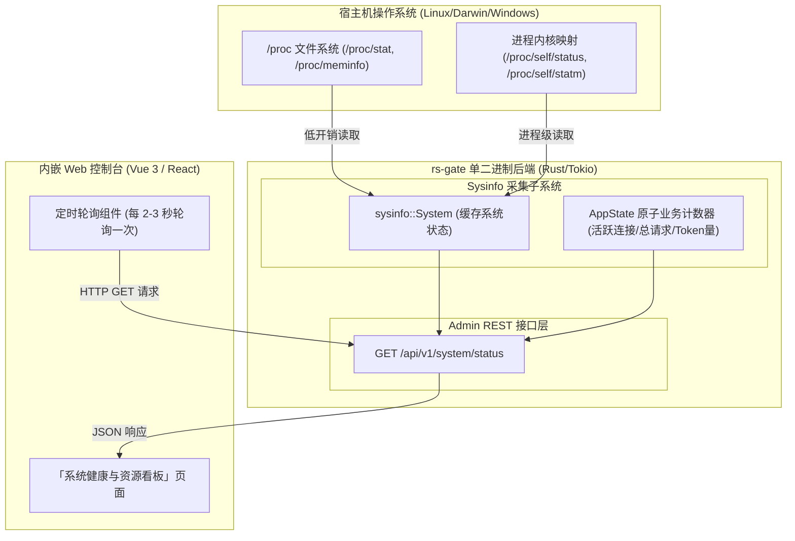
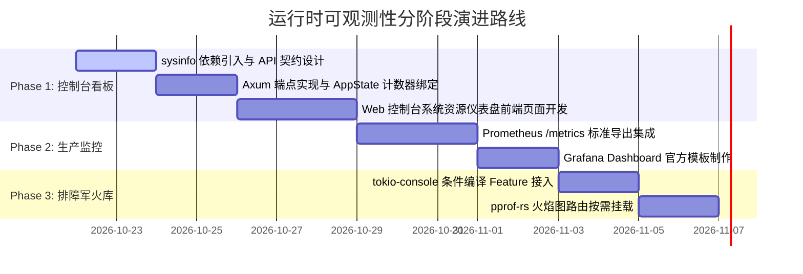

# 07. 运行时可观测性与系统诊断架构规范 (Runtime Observability, Metrics and Diagnostics)

本文档针对技术评审中关于**“Rust 生态如何对标 Go pprof 进行线程、内存与 CPU 监测”**，以及**“自建 Web 控制台如何以极简、低开销方式展现系统与进程运行指标”**的关切，提供系统性的架构权衡、选型对比与实施方案提议。

---

## 1. 架构核心结论与提议概要 (Executive Summary)

1. **清晰划分两个层级，避免“杀鸡用牛刀”**：
   - **日常业务与系统看板（轻量级状态采集）**：面向管理员和 Web 控制台，展示 CPU 忙闲、整机与进程内存（RSS）、操作系统线程数、并发连接数等。**完全不需要引入任何重型 Profiling 工具或 pprof 组件**。通过标准的 Rust 跨平台轻量库（如 `sysinfo`）配合 Axum 暴露一个轻量 REST API 即可实现纳秒级采样，开销趋近于零。
   - **深度故障排查与性能调优（深度代码级 Profiling）**：面向开发人员排查热点代码、内存泄漏、协程卡死等场景。Rust 拥有**完全对标甚至超越 Go pprof 的独立生态方案**（如 `tokio-console` 对标 Goroutine dump、`jemalloc/jeprof` 对标 Heap profile、`pprof-rs` 对标 CPU profile）。此类工具应通过 **Cargo Feature（条件编译）** 或外部非侵入工具链挂载，不在默认生产运行时引入任何性能包袱。

2. **核心架构提议路线**：
   - **阶段一（Web 控制台集成）**：引入 `sysinfo`，在现有 Axum 架构中挂载 `GET /api/v1/system/status` 端点，前端控制台增加独立「系统健康与资源看板」面板。
   - **阶段二（企业级标准采集）**：通过 `metrics` + `metrics-exporter-prometheus` 暴露标准 Prometheus `/metrics` 接口，无缝对接企业 Grafana。
   - **阶段三（专家诊断军火库）**：通过 `--features profile` 编译开关，按需激活 `tokio-console` 与 `pprof-rs`，实现线上疑难杂症的毫秒级诊断。

---

## 2. Go pprof 机制与 Rust 观测体系全方位映射

Go 语言在语言运行时（Runtime）中内嵌了垃圾回收器（GC）、Goroutine 调度器与全局分配器，因此天然提供了集成式的 `net/http/pprof`。
Rust 坚守 **零成本抽象（Zero-Cost Abstractions）** 与 **无强制运行时（No Mandatory Runtime）** 哲学，其监测与诊断体系映射如下：

| 监控与排查维度 | Go 传统方案 (`pprof`) | Rust 对应方案 (对应工具与标准库) | 运行时开销 | 核心应用场景与定位 |
| :--- | :--- | :--- | :--- | :--- |
| **系统与进程状态看板**<br>(CPU/内存/线程数) | `/debug/pprof/` 部分信息，或额外调用 `runtime.ReadMemStats` | **`sysinfo` 库 (读取 `/proc` / 内核 API)** | **纳秒级 (趋近于零)** | **推荐用于 rs-gate Web 控制台前端面板** |
| **协程/并发任务状态**<br>(Task / Goroutine Dump) | `/debug/pprof/goroutine`<br>(查看全部协程栈) | **`tokio-console`**<br>(基于 `console-subscriber`) | 低 (需编译 feature 开启) | 实时监控 Tokio Task 状态、Poll 耗时、异步死锁与长任务阻塞 |
| **CPU 瓶颈与火焰图** | `/debug/pprof/profile`<br>(配合 `go tool pprof`) | **`pprof-rs`** (TiKV 出品，支持 pprof protobuf)<br>或 **`cargo-flamegraph` / Linux `perf`** | 采样期微小开销 | 生产/测试环境火焰图采样，定位消耗 CPU 的核心业务函数 |
| **堆内存分配与泄漏** | `/debug/pprof/heap`<br>(堆对象与未回收采样) | **`tikv-jemallocator` + `jeprof`**<br>或 **`dhat-rs`** (精准生命周期分析) | 极低 / 生产可长开 | 堆内存峰值分析、查找未释放的内存泄漏点 |
| **线程死锁与锁争用** | `/debug/pprof/mutex`<br>`/debug/pprof/block` | **`parking_lot` (自带死锁检测线程)**<br>`tokio-console` (异步锁争用检测) | 极低 | 检测读写锁竞争与线程阻塞 |
| **全链路结构化追踪** | `net/trace` 或 OpenTelemetry | **`tracing` 生态** (`tracing-subscriber`, OTel) | 可控 (基于过滤级别) | 贯穿 HTTP 请求、SSE 流转发全生命周期耗时分析 |

---

## 3. Web 控制台系统看板技术方案 (Tier 1: 轻量常态监控)

### 3.1 架构设计与数据链路

针对当前 rs-gate 单二进制架构，Web 控制台无需复杂探针，直接复用内部 Axum 路由引擎：



### 3.2 接口契约规范 (`GET /api/v1/system/status`)

后端返回结构聚合 **宿主机基础指标**、**rs-gate 本进程消耗指标** 与 **网关核心运行时指标**：

```json
{
  "code": 0,
  "message": "success",
  "data": {
    "host": {
      "cpu_usage_pct": 14.5,
      "cpu_core_count": 4,
      "memory_total_bytes": 17179869184,
      "memory_used_bytes": 6871947673,
      "memory_free_bytes": 10307921511
    },
    "process": {
      "pid": 12894,
      "cpu_usage_pct": 1.2,
      "memory_rss_bytes": 48234496,
      "memory_vss_bytes": 1245184000,
      "thread_count": 9,
      "fd_count": 34,
      "uptime_seconds": 86400
    },
    "gateway_runtime": {
      "active_proxy_connections": 18,
      "total_requests_processed": 542031,
      "total_tokens_forwarded": 12894500,
      "tokio_workers_count": 4,
      "sqlite_pool_active": 2,
      "sqlite_pool_idle": 8
    }
  }
}
```

### 3.3 核心实现细节与性能防护

1. **避免频繁重建 `System` 结构体**：
   `sysinfo::System` 内部维持了 CPU 时间切片差值计算所需的上下文。最佳做法是将 `System` 封装在 `AppState` 的 `tokio::sync::Mutex` 或标准锁中，复用该实例，只在每次请求时调用 `refresh_specifics`（只刷新 CPU、内存与本进程，不扫描全局成百上千的其他系统进程）。
2. **轻量增量刷新**：
   ```rust
   // 仅定向刷新本进程，开销低至微秒级
   sys.refresh_processes_specifics(
       std::iter::once(current_pid),
       ProcessRefreshKind::everything(),
   );
   ```
3. **零阻塞异步集成**：
   采集过程仅涉及极少量系统调用（几次内核 `read`），耗时在微秒（$\mu s$）级别，完全可在 Axum 异步任务中瞬时完成，不会阻塞 Tokio Worker 调度。

---

## 4. 深度诊断与排障军火库设计 (Tier 2: 专家级按需诊断)

对于需要深入代码级别的性能剖析需求，设计以下可插拔机制：

### 4.1 方案一：`tokio-console` (协程堆栈与任务卡死诊断)
* **定位**：对标 Go 的 `/debug/pprof/goroutine`。
* **价值**：实时展示所有 Tokio Tasks 的状态。如果某个开发者不慎在异步代码中调用了同步阻塞 I/O，或者某个 SSE 请求由于客户端异常断开而导致 Task 挂起泄漏，在 `tokio-console` 中可以一览无余地查出哪个 Task 的 `busy_duration` 异常高。
* **接入方式**：
  ```rust
  // Cargo.toml
  // [dependencies]
  // console-subscriber = { version = "0.4", optional = true }
  
  #[cfg(feature = "console")]
  console_subscriber::init();
  ```
  通过 `cargo run --features console` 启动，开发排障人员使用本地 `tokio-console` 命令行直连网关端口（默认 6669）查看交互式 TUI 界面。

### 4.2 方案二：`pprof-rs` (兼容 Go 生态的在线 CPU 火焰图)
* **定位**：对标 Go 的 `/debug/pprof/profile`。
* **价值**：直接在 Axum 的私有管理路由挂载诊断端点：
  * `GET /debug/pprof/flamegraph`：直接返回原生交互式 SVG 火焰图，在浏览器中打开即可查看 CPU 热点。
  * `GET /debug/pprof/profile`：输出兼容 Google Pprof Protobuf 格式文件，团队内熟悉 Go 工具链的工程师可以直接使用熟悉的 `go tool pprof` 命令进行性能比对：
    ```bash
    go tool pprof -http=:8080 http://localhost:8999/debug/pprof/profile?seconds=5
    ```

### 4.3 方案三：`jemalloc` + `jeprof` (生产级堆内存泄漏诊断)
* **定位**：对标 Go 的 `/debug/pprof/heap`。
* **价值**：生产环境中若怀疑存在内存泄漏，通过 `tikv-jemallocator` 替代系统默认的 malloc 分配器。结合环境变量 `MALLOC_CONF="prof:true"`，可以在不中断服务的情况下动态导出 Dump 堆内存文件，配合 `jeprof` 分析是哪一块数据结构在持续吃内存。

---

## 5. 架构演进与落地实施路线 (Roadmap)



### 阶段建议
1. **立即执行（Milestone 4 前端控制台期间）**：
   - 实施 **Tier 1** 方案，在控制台增加「系统状态」页面，满足日常运维直观掌握系统负载、进程内存和线程数的需求。
2. **生产就绪（Milestone 5 加固期间）**：
   - 补充 Prometheus `/metrics` 导出，便于接入企业集中监控告警系统。
3. **长期储备**：
   - 保持 `tokio-console` 与 `pprof-rs` 的 Feature 编译脚手架，作为团队应对极端性能挑战的标准化工具。

---

## 6. 架构决策与沟通建议总结 (Architect Talking Points)

当向架构师汇报时，可重点阐述以下三点核心判断：

1. **“理念解耦，按需配置”**：
   Go 将 pprof 捆绑进 runtime 是因为 GC 和运行时调度是黑盒；而 Rust 的无运行时特性让我们**可以用极低的成本、极轻量的代码（仅靠 `sysinfo` + REST API）实现控制台资源监控**，不需要为了看几个百分比而背上厚重的 Profiling 依赖。
2. **“安全无副作用”**：
   前端控制台日常轮询系统指标对服务主路径（LLM SSE 代理）没有任何性能干扰，内存开销为 0，符合 rs-gate 单二进制、极简交付的架构宗旨。
3. **“工具链完全兼容”**：
   在真正遇到性能攻坚需求时，Rust 生态不仅有针对异步任务的原生利器 `tokio-console`，更有能无缝生成 `pprof protobuf` 的 `pprof-rs`，团队积累的 `go tool pprof` 分析经验和习惯可以 100% 得到复用。
