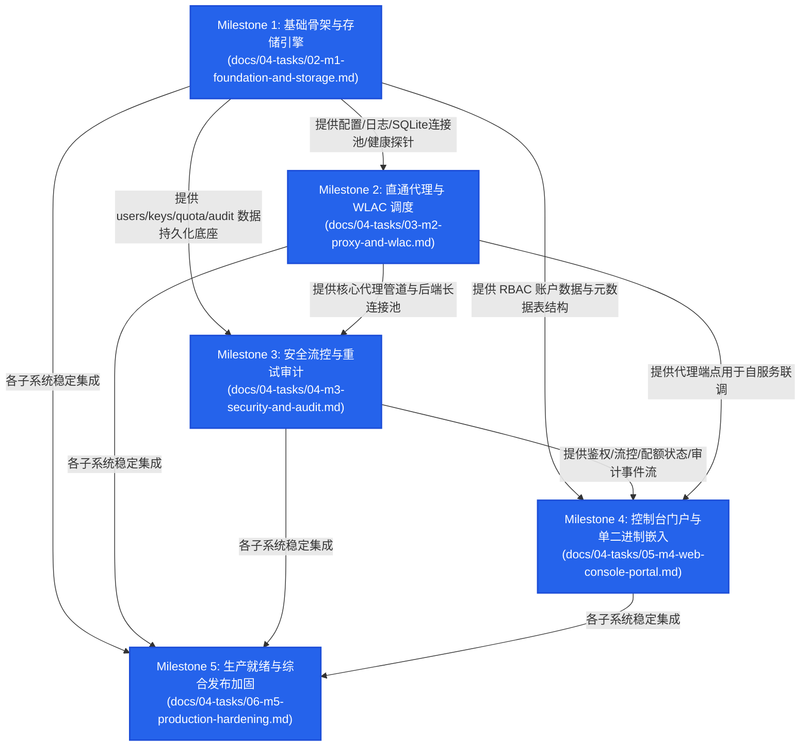
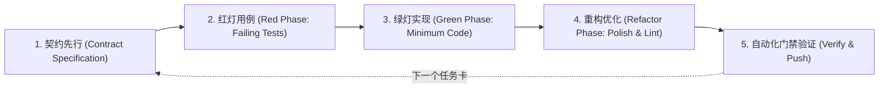

# rs-gate 阶段三工程实施总纲与路线图 (Engineering Roadmap & Gating Criteria)

- **文档编号**：`01-roadmap.md`
- **文档版本**：`v1.0.0`
- **编制日期**：2026-10-19
- **当前阶段**：阶段三：接口契约与任务分解 (第 4 步：工程实施路线图总纲篇)
- **基准依赖**：
  - 需求矩阵：[`docs/01-features/01-feature-matrix.md`](file:///home/fugui/rusts/rs-gate/docs/01-features/01-feature-matrix.md)
  - 架构设计：[`docs/02-design/01-system-architecture.md`](file:///home/fugui/rusts/rs-gate/docs/02-design/01-system-architecture.md) ~ `05-web-console.md`
  - 接口契约：[`docs/03-api/01-gateway-api.md`](file:///home/fugui/rusts/rs-gate/docs/03-api/01-gateway-api.md) ~ `03-database-schema.md`
- **目标产物矩阵**：[`docs/04-tasks/`](file:///home/fugui/rusts/rs-gate/docs/04-tasks/)（`01-roadmap.md` ~ `06-m5-production-hardening.md`）
- **状态**：定稿待审 (Ready for Review)

---

## 1. 规范概述与演进路线 (Engineering Roadmap Overview)

### 1.1 项目使命与工程愿景
**rs-gate** 是采用 Rust 构建的高性能、轻量级、企业级单二进制大模型内部透明代理网关。
为杜绝“先码代码再补设计”导致的架构腐化、死锁与性能断崖，本项目全周期推行 **规范驱动开发 (Spec-Driven Development, SDD)** 与 **测试驱动开发 (Test-Driven Development, TDD)**。

本实施路线图作为阶段三工程实施的顶层总纲，明确里程碑划分、依赖拓扑、测试先行规范与全局门禁红线，指导各里程碑独立作战卡（Milestone Cards）的有序落地。

### 1.2 里程碑演进全景图 (Milestones Evolution)

```
+----------------------------------------------------------------------------------------------------+
|                                      rs-gate 演进全景路线图                                         |
+----------------------------------------------------------------------------------------------------+
| Milestone 1: 基础骨架与存储引擎 (Foundation & Storage Engine)                                        |
|  - Cargo 依赖拓扑、多源配置 (YAML/ENV)、tracing 结构化日志、SQLite WAL 存储引擎、声明式自迁移、存活探针     |
+----------------------------------------------------------------------------------------------------+
                                                 |
                                                 v
+----------------------------------------------------------------------------------------------------+
| Milestone 2: 直通代理与 WLAC 调度 (Proxy Pipeline & WLAC Scheduler)                                  |
|  - 6 大多协议直通端点、无除法 WLAC 加权调度、ActiveConnectionGuard (RAII 防泄漏)、零缓冲 SSE、Usage 增量解析 |
+----------------------------------------------------------------------------------------------------+
                                                 |
                                                 v
+----------------------------------------------------------------------------------------------------+
| Milestone 3: 安全流控与重试审计 (Security Governance & Retry Pipeline)                               |
|  - Key 加盐 Hash、CIDR/模型白名单、无锁原子 CAS 令牌桶 (RPM)、日/周 Token 双配额、首字前静默重试、批量落盘 Worker |
+----------------------------------------------------------------------------------------------------+
                                                 |
                                                 v
+----------------------------------------------------------------------------------------------------+
| Milestone 4: 控制台门户与单二进制嵌入 (Web Console & Single Binary)                                  |
|  - JWT RBAC 中间件、用户自服务 REST API、管理员治理 REST API、Vanilla CSS 控制台 SPA、rust-embed 编译期内嵌 |
+----------------------------------------------------------------------------------------------------+
                                                 |
                                                 v
+----------------------------------------------------------------------------------------------------+
| Milestone 5: 生产就绪与综合发布加固 (Production Hardening & Release)                                 |
|  - Prometheus /metrics 与就绪探针、历史审计 TTL 滚动清理与增量收缩、全链路 E2E 回归、跨平台静态构建 (<=25MB) |
+----------------------------------------------------------------------------------------------------+
```

---

## 2. 里程碑依赖 DAG 拓扑图 (Milestone Dependency DAG)

系统采用模块化分层演进策略，各里程碑存在严密的拓扑序依赖：



---

## 3. 通用 TDD 循环工作流规范 (TDD Cycle Workflow)

在各个里程碑的工程落地过程中，坚决抵制“先写业务代码再补测试”的传统习惯，强制实施 **测试先行、红绿重构** 的标准 TDD 闭环：



### 3.1 阶段实施细则
1. **红灯阶段 (Red Phase)**：
   - 依赖设计与 API 契约文档，先在 `tests/` 目录下编写对应集成测试或在 `src/` 中定义单元测试用例。
   - 包含明确的输入构造、边界条件与断言逻辑（`assert_eq!`, `assert!`, `assert_matches!`）。
   - 运行测试必须确定性失败（编译期未实现报错或断言失败），严禁伪测试。
2. **绿灯阶段 (Green Phase)**：
   - 编写满足测试通过所需的最小业务代码。
   - 严禁过度设计，优先保障业务路径打通与功能契约达成。
   - 运行 `cargo test` 验证红灯用例全部转为通过（Passed）。
3. **重构阶段 (Refactor Phase)**：
   - 消除代码坏味道、消除隐式锁竞争、优化内存分配与克隆。
   - 保持测试用例持续绿灯状态。
   - 运行静态分析与格式检查，确保无破坏性变更。

---

## 4. 全局工程目录规范 (Global Project Directory Layout)

项目物理代码结构严格遵循以下工程目录标准：

```text
rs-gate/
├── Cargo.toml                      # 根项目构建清单与全量依赖管理
├── Cargo.lock                      # 锁定依赖精确版本
├── Makefile                        # 快捷编译、格式化、测试与跨平台打包脚本
├── README.md                       # 项目主页与开发快速指引
├── AGENTS.md                       # Agent 行为准则与架构宪法
├── migrations/                     # 声明式 SQLite 数据库迁移脚本
│   ├── 20261019000000_init.sql     # 7 张物理表初始结构 DDL
│   └── 20261019000001_indexes.sql  # 性能索引创建 DDL
├── docs/                           # 规范文档库
│   ├── 00-prompt/                  # 引导提示词
│   ├── 01-features/                # 特性矩阵与边界
│   ├── 02-design/                  # 系统架构设计
│   ├── 03-api/                     # 接口与数据契约
│   └── 04-tasks/                   # 模块化实施作战任务卡 (当前)
├── src/                            # 后端核心源码
│   ├── main.rs                     # 服务启动入口与全局依赖编排
│   ├── server.rs                   # Axum HTTP 服务生命周期与平滑停机
│   ├── telemetry.rs                # tracing 结构化日志与上下文追踪
│   ├── config/                     # 配置加载引擎
│   │   ├── mod.rs                  # 配置结构体定义与合并逻辑
│   │   └── options.rs              # 配置字段校验器与默认值
│   ├── storage/                    # SQLite WAL 持久化存储
│   │   ├── mod.rs                  # 存储模块根导出
│   │   ├── db.rs                   # 连接池初始化与 Pragmas 调优
│   │   ├── migration.rs            # 声明式迁移版本控制与执行器
│   │   └── bootstrap.rs            # 默认超级管理员自注入
│   ├── routing/                    # 路由与负载均衡
│   │   ├── mod.rs                  # 路由表定义与读写分离
│   │   ├── scheduler.rs            # WLAC 加权最小活跃长连接调度器
│   │   └── backend.rs              # 物理后端节点实例与状态
│   ├── proxy/                      # 核心反向代理引擎
│   │   ├── mod.rs                  # 代理路由器挂载
│   │   ├── handler.rs              # 6 大直通端点处理逻辑
│   │   ├── client.rs               # Reqwest 长连接池管理与凭据替换
│   │   ├── guard.rs                # ActiveConnectionGuard (RAII 自动析构)
│   │   ├── stream.rs               # 逐 Chunk 零缓冲流式管道与 Usage 解析
│   │   └── retry.rs                # 上游静默重试、Full Jitter 退避与 Failover
│   ├── auth/                       # 鉴权与安全访问控制
│   │   ├── mod.rs                  # 鉴权中间件与上下文注入
│   │   ├── key.rs                  # 虚拟 Key 内存缓存与加盐 Hash 校验
│   │   └── ip.rs                   # CIDR IP 白名单匹配器
│   ├── limiting/                   # 高性能流控与配额
│   │   ├── mod.rs                  # 流控中间件
│   │   ├── token_bucket.rs         # AtomicU64 CAS 无锁令牌桶 (RPM)
│   │   ├── concurrency.rs          # AtomicUsize 瞬时并发门限控制器
│   │   └── quota.rs                # 日/周双周期 Token 配额与午夜重置引擎
│   ├── audit/                      # 异步审计流水与清理
│   │   ├── mod.rs                  # 审计通道与事件定义
│   │   ├── worker.rs               # Tokio mpsc 有界通道与批量事务落盘 Worker
│   │   └── retention.rs            # 历史审计 TTL 滚动清理与 Incremental Vacuum
│   ├── admin/                      # Web 控制台与 REST API
│   │   ├── mod.rs                  # /api 路由注册
│   │   ├── auth.rs                 # JWT 签发/校验与 RBAC 拦截
│   │   ├── user_api.rs             # 普通开发者自服务 API 处理器
│   │   ├── admin_api.rs            # 管理员治理与统计 API 处理器
│   │   └── embedded.rs             # rust-embed 静态资产服务与 SPA 回退
│   └── metrics.rs                  # Prometheus 指标注册与 /metrics 端点
├── web/                            # 前端控制台源码 (Vanilla CSS + JS SPA)
│   ├── package.json                # 前端开发依赖与构建脚本
│   ├── src/                        # 前端源码
│   │   ├── index.html              # SPA 唯一入口页面
│   │   ├── styles/                 # 核心设计系统与组件样式
│   │   ├── scripts/                # 业务逻辑模块与路由控制器
│   │   └── assets/                 # 图标与静态图片
│   └── dist/                       # 前端编译产物 (嵌入 Rust 二进制)
└── tests/                          # 统一集成与端到端测试套件
    ├── common/                     # 测试共享夹具与辅助组件
    │   ├── mod.rs                  # 内存/临时目录 SQLite 夹具 (TestDbHarness)
    │   └── mock_llm.rs             # Mock LLM 后端服务器 (wiremock / axum)
    ├── storage_migration_test.rs   # M1: 存储迁移与初始化测试
    ├── health_probe_test.rs        # M1: 健康探针测试
    ├── wlac_scheduler_test.rs      # M2: WLAC 调度算法交叉乘法测试
    ├── proxy_passthrough_test.rs   # M2: 6 大端点透传契约测试
    ├── sse_stream_test.rs          # M2: SSE 零缓冲流式透传与中断测试
    ├── auth_middleware_test.rs     # M3: 虚拟 Key 与白名单鉴权测试
    ├── rate_limit_test.rs          # M3: 无锁令牌桶 RPM 与并发限流测试
    ├── quota_limit_test.rs         # M3: 日/周配额拦截与重置测试
    ├── retry_failover_test.rs      # M3: 静默重试与故障转移测试
    ├── stream_retry_boundary_test.rs # M3: 首字前重试与首字后优雅中止测试
    ├── audit_batch_worker_test.rs  # M3: 异步审计批量落盘一致性测试
    ├── admin_auth_rbac_test.rs     # M4: 控制台 RBAC 权限与数据隔离测试
    ├── user_portal_api_test.rs     # M4: 普通用户自服务 API 测试
    ├── admin_operations_test.rs    # M4: 管理员治理/热更新/导出测试
    ├── embedded_assets_test.rs     # M4: 静态资源内嵌与 SPA 路由测试
    ├── metrics_scrape_test.rs      # M5: Prometheus 度量抓取测试
    ├── retention_cleanup_test.rs   # M5: 审计日志 TTL 滚动清理测试
    └── e2e_full_flow_test.rs       # M5: 全链路端到端综合回归测试
```

---

## 5. 全局总验收门禁准则 (Global Gating Criteria)

在每个阶段以及最终版本发布前，必须满足以下硬性门禁准则：

### 5.1 静态与代码质量门禁 (Code Quality Gates)
1. **代码格式统一**：
   - 运行 `cargo fmt --check` 必须零报错。
2. **静态分析零警告 (Zero-Warning Policy)**：
   - 运行 `cargo clippy --all-targets -- -D warnings` 必须通过且零警告。
3. **消除裸露异常**：
   - 业务路径严禁使用未捕获的 `unwrap()` 或 `expect()`，统一采用强类型错误枚举（`thiserror`）并向上传播。

### 5.2 测试覆盖与自动化验证门禁 (Test Gates)
1. **全量测试通过**：
   - 运行 `cargo test --all` 必须 100% 通过，无忽略用例或挂起用例。
2. **无竞争并发测试**：
   - 多线程测试用例使用 `cargo test -- --test-threads=4`，验证内存状态在并发读写下无死锁与数据不一致。

### 5.3 生产运行时性能与打包指标 (Runtime & Artifact Gates)
1. **单二进制交付**：
   - `web/dist/` 构建产物必须完全嵌入 Rust 目标二进制，系统运行时不依赖外部前端文件目录。
2. **静态二进制体积控制**：
   - `musl` 静态编译产物通过 `strip` 优化后，可执行文件体积严格控制在 $\le 25\text{MB}$。
3. **性能底线指标**：
   - 网关代理中继开销（除上游大模型生成本身耗时外）：$P99 \le 1.5\text{ms}$。
   - SSE 首字透传附加延迟（TTFT Overhead）：$\le 1.0\text{ms}$。

---

## 6. 里程碑任务矩阵与追踪总表 (Milestone Task Matrix)

| 阶段编号 | 作战卡文档 | 核心特性范围 | 前置依赖 | 关键测试验证目标 | 状态 |
| :---: | :--- | :--- | :---: | :--- | :---: |
| **M1** | [`02-m1-foundation-and-storage.md`](file:///home/fugui/rusts/rs-gate/docs/04-tasks/02-m1-foundation-and-storage.md) | 基础骨架、配置管理、SQLite WAL 存储连接池、自迁移 DDL、默认超管、存活探针 | 无 | 幂等建表与索引、默认管理员注入、`/health/live` 响应 | **已完成 (Completed)** |
| **M2** | [`03-m2-proxy-and-wlac.md`](file:///home/fugui/rusts/rs-gate/docs/04-tasks/03-m2-proxy-and-wlac.md) | 6 大原生直通端点、无除法 WLAC 调度、ActiveConnectionGuard、零缓冲 SSE、Usage 解析、Abort 级联 | M1 | WLAC 交叉乘法选路、逐 Chunk 实时透传、流中断长连接回收 | **已完成 (Completed)** |
| **M3** | [`04-m3-security-and-audit.md`](file:///home/fugui/rusts/rs-gate/docs/04-tasks/04-m3-security-and-audit.md) | 虚拟 Key 鉴权、CIDR 白名单、无锁原子 CAS 令牌桶、日/周配额、静默重试与 Failover、批量审计 Worker | M1, M2 | 401/403/429 拦截、首字前重试、首字后优雅中止、批量落盘一致性 | **已完成 (Completed)** |

| **M4** | [`05-m4-web-console-portal.md`](file:///home/fugui/rusts/rs-gate/docs/04-tasks/05-m4-web-console-portal.md) | JWT RBAC 中间件、用户自服务 API、管理员治理 API、Vanilla CSS 控制台 SPA、`rust-embed` 单二进制 | M1, M3 | 角色权限强隔离、后端探活与热重载、CSV 流式导出、SPA 路由回退 | 待实施 |
| **M5** | [`06-m5-production-hardening.md`](file:///home/fugui/rusts/rs-gate/docs/04-tasks/06-m5-production-hardening.md) | Prometheus `/metrics` 与就绪探针、审计 TTL 滚动清理、全链路端到端回归套件、musl 静态打包发布 | M1~M4 | 指标抓取准确性、过期日志物理清理、全链路 E2E 绿灯、产物体积 $\le 25\text{MB}$ | 待实施 |
